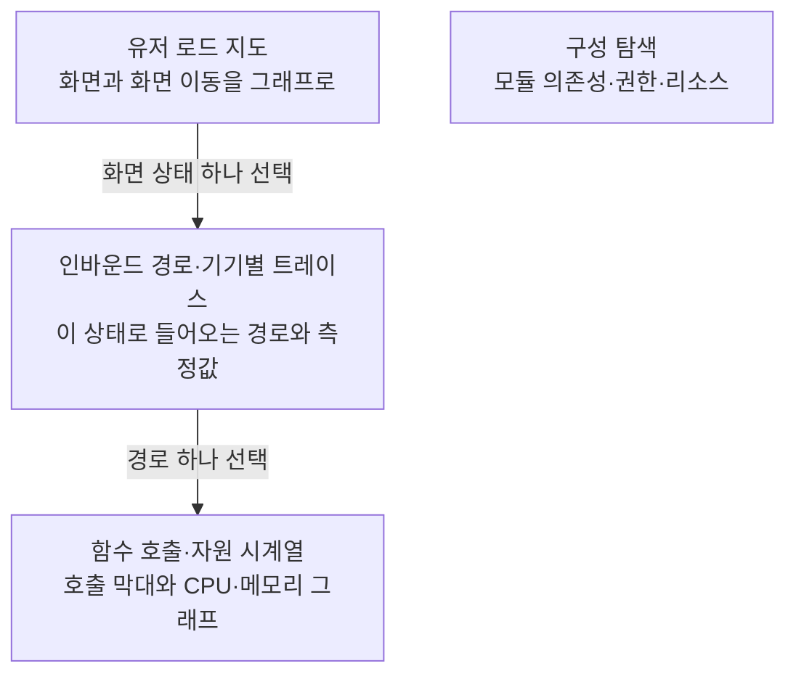

"이 화면 왜 이렇게 느려요?"라는 질문을 받으면 보통 이렇게 한다. 앱을 켜고, 그 화면까지 손으로 찾아 들어가고, 프로파일러를 붙여서 한 번 녹화하고, 타임라인에서 그 화면이 뜬 구간을 눈으로 찾는다. 다른 경로로 들어오면 느린지, 다른 기기에서는 어떤지는 그 과정을 다시 반복해야 안다. 화면이 스무 개를 넘기면 "이 앱에 화면이 몇 개고 각각 어디서 들어오는지"부터 바로 답하기 어려워진다.

이 문제를 도구로 풀어 보려고 [android-apm](https://github.com/android-apm-tool/android-apm) 을 만들기 시작했다. 이 시리즈는 그 과정을 기록한다. 1편은 코드보다 먼저, 왜 이걸 만드는지와 다 만들어지면 어떻게 쓰게 되는지를 정리한다.

웹 프론트엔드든 iOS든 "화면이 여러 개 있고, 화면 사이를 오가는 앱"이라면 안드로이드 부분을 자기 플랫폼으로 바꿔 읽어도 문제를 이해하는 데는 차이가 없다.

## 용어 몇 개만 맞추고 가자

APM(Application Performance Monitoring)은 앱이 실제로 돌 때 무엇이 얼마나 걸리고 자원을 얼마나 쓰는지 모아 보여주는 도구를 통칭한다. 여기서는 개발자 PC에서 쓰는 분석 도구를 가리킨다. 운영 중인 사용자 앱에서 지표를 걷어 가는 서비스 이야기는 아니다.

나머지는 이 글에서 자주 나오는 말이다.

| 용어 | 이 글에서의 뜻 |
|---|---|
| Composable | 안드로이드의 UI 프레임워크인 [Jetpack Compose](https://developer.android.com/develop/ui/compose/mental-model)에서 화면 조각을 그리는 함수. 버튼 하나도, 화면 전체도 Composable이다 |
| Navigation 3 (Nav3) | 화면 사이 이동을 관리하는 [구글의 Compose용 라이브러리](https://developer.android.com/guide/navigation/navigation-3). "이 키가 오면 이 화면을 그린다"는 등록을 코드에 적는다 |
| variant | 같은 앱의 빌드 종류. debug, release, 무료판·유료판 같은 [빌드 변형](https://developer.android.com/build/build-variants) |
| IR | Kotlin 컴파일러가 소스를 읽은 뒤 기계어로 바꾸기 전에 들고 있는 중간 표현. 함수, 호출, 타입 관계가 다 들어 있다 |
| 화면 상태 | 같은 화면의 로딩 중·내용 표시·빈 결과·오류 같은 서로 다른 모습 |

## 손으로 재면 생기는 일

이 블로그의 지난 글 [썸네일로 바꿨는데 70ms밖에 안 줄었다](/posts/image-latency-is-round-trips/) 에서 마이페이지 하나의 로딩 시간을 쟀다. 화면이 쓸 수 있게 되는 순간을 정하려고 측정용 코드를 화면에 직접 붙였고, 앱을 죽였다 켜는 adb 스크립트를 짜서 150번을 돌렸다. 화면 하나, 진입 경로 하나에 그 정도 품이 들었다.

이 작업을 화면마다 하려면 세 가지가 걸린다.

첫째, 대상 목록이 없다. 어떤 화면이 있고 각 화면에 어디서 들어올 수 있는지는 코드에만 흩어져 있다. 홈에서 들어오는 경로, 알림을 눌러 바로 들어오는 경로, 다른 탭에서 넘어오는 경로가 같은 화면으로 이어지는데 각각 비용이 다를 수 있다. 사람이 기억하는 경로만 재게 된다.

둘째, 측정 결과가 화면과 묶여 있지 않다. [Android Studio 프로파일러](https://developer.android.com/studio/profile)나 [Perfetto](https://perfetto.dev/docs/)는 녹화한 시간 구간 안의 함수 호출과 CPU·메모리를 아주 자세히 보여준다. 그런데 출발점이 "시간"이다. 녹화 구간 중 어디서 어떤 화면이 떴는지는 내가 찾아야 한다. [Macrobenchmark](https://developer.android.com/topic/performance/benchmarking/macrobenchmark-overview)는 반복 측정을 자동으로 해 주지만, 어떤 화면을 어떤 순서로 열지는 내가 시나리오로 짜야 한다. [Firebase Performance Monitoring](https://firebase.google.com/docs/perf-mon) 같은 운영 지표 서비스는 사용자 기기에서 모은 집계값을 준다. 개발 중에 "이 경로로 들어왔을 때 어떤 함수가 몇 ms를 썼나"까지 내려가는 용도는 아니다.

셋째, 측정 조건이 흩어진다. 같은 화면이라도 기기, OS, 캐시 상태에 따라 수치가 크게 바뀐다. 지난 글에서도 40분 간격으로 잰 두 결과가 p95 기준 1,496ms와 1,135ms로 달랐다. 어떤 기기에서 어떤 조건으로 잰 값인지가 수치 옆에 붙어 있지 않으면 나중에 비교할 수가 없다.

프로파일러의 정밀도는 지금도 충분하다. 내게 없었던 건 그 앞 단계인 화면 목록과 진입 경로였다. 그걸 먼저 손에 쥐고, 측정은 그 위에 붙이고 싶었다.

## 그래서 만들려는 것

프로젝트에 플러그인을 적용하고 APM 작업을 실행하면, 앱에 있는 화면과 각 화면으로 들어가는 경로를 코드에서 찾아내고, 실제 기기에서 그 화면까지 가는 동안의 함수 호출과 자원 사용량을 재서, 개발 PC의 localhost 대시보드에 화면 기준으로 보여준다.

이걸 두 단계로 나눠서 한다.

1. 빌드할 때: 컴파일러가 들고 있는 코드 구조(IR)를 읽어 화면 목록과 화면 사이 이동 후보를 만든다. 앱을 실행하지 않아도 알 수 있는 것들이다.
2. 실행할 때: 계측을 넣은 앱을 실제 기기에서 돌려 함수 호출, CPU·메모리·디스크, 네트워크 요청을 기록하고 PC의 로컬 서버로 보낸다.

로컬 서버가 둘을 합친다. 빌드 때 만든 목록이 뼈대가 되고, 실행 기록이 그 위에 붙는다.

<iframe src="/assets/diagrams/2026-10-13-android-apm-1-why.html"
        title="Android APM 구조 다이어그램: 빌드 때 화면 목록을 만들고, 기기 실행 기록과 로컬 서버에서 합쳐 대시보드로 보여준다"
        loading="lazy" width="100%" height="600"
        style="border:1px solid var(--main-border-color); border-radius:6px;"></iframe>

> 잘려 보이면 [전체 화면으로 열기](/assets/diagrams/2026-10-13-android-apm-1-why.html).
{: .prompt-tip }

빌드 단계를 Kotlin [컴파일러 플러그인](https://kotlinlang.org/docs/custom-compiler-plugins.html)으로 하는 이유는 화면을 찾는 기준이 함수 이름이 될 수 없어서다. `HomeScreen` 이라는 이름의 함수가 화면이라는 보장도 없고, `Screen` 이 안 붙은 함수가 화면이 아니라는 보장도 없다. 어떤 Composable이 Nav3의 어떤 키에 등록되는지, 어떤 콘텐츠가 로그인 여부 같은 조건으로 바뀌어 그려지는지는 호출과 전달 관계를 따라가야 보인다. 그 관계가 가장 온전하게 남아 있는 곳이 컴파일 중의 IR이다.

## 다 만들어지면 이렇게 쓴다

사용자가 하는 일은 플러그인 적용과 작업 실행 두 가지다. 플러그인을 적용하거나 Gradle Sync를 하는 것만으로 앱이나 서버가 뜨지는 않는다. 명시적으로 APM 작업을 실행할 때만 수집과 실행이 시작된다.

```kotlin
// app/build.gradle.kts — 지금 샘플 앱에 실제로 적용돼 있는 형태
plugins {
    alias(libs.plugins.android.application)
    alias(libs.plugins.kotlin.compose)
    id("io.github.android-apm-tool.apm")
}
```

그다음 실행할 작업은 설계 문서에 이름만 정해 둔 상태다. 아직 구현되지 않은 제안이다.

```bash
# 설계안의 작업 이름 (아직 없음). <Variant> 자리에 Debug 같은 빌드 종류가 들어간다
./gradlew :app:apmCollectDebugCatalog   # 모듈마다 화면·진입 경로 후보 수집
./gradlew :app:apmMergeDebugCatalog     # 모듈 결과를 앱 하나의 목록으로 병합
./gradlew :app:apmRunDebug              # 분석 → 빌드 → 서버 → 기기 실행까지 한 번에
```

`apmRunDebug` 가 끝나면 브라우저로 localhost를 연다. 대시보드는 네 화면으로 구성하기로 정했고, 앞의 셋은 위에서 아래로 파고드는 순서다.



유저 로드 지도는 화면을 노드로, 화면 이동을 화살표로 그린다. 노드마다 로딩·내용·오류 같은 상태가 따로 달려 있어서 "이 화면의 오류 상태"처럼 상태 단위로 골라 들어갈 수 있다. 여기서 화면들을 골라 분석 범위를 정하는데, 이 범위를 유저 로드라고 부른다.

상태를 고르면 그 상태로 들어오는 모든 경로가 한 페이지에 나온다. 홈에서 버튼을 눌러 들어온 경우, 알림에서 바로 들어온 경우가 따로 줄을 서고, 각 줄에 측정값과 측정한 기기 정보가 붙는다. 여러 기기에서 잰 결과는 섞지 않고 기기별로 고른다.

경로 하나를 누르면 시계열이 열린다. 왼쪽에는 화면 UI가 있고 각 UI 조각이 다 그려진 시점이 시간축에 화살표로 이어진다. 가운데에는 함수 호출이 실행된 순서대로 막대로 늘어서는데, 같은 함수를 열 번 불렀으면 막대도 열 개다. "10회 호출, 평균 3ms"로 뭉뚱그리지 않는다. 오른쪽에는 CPU, 메모리, 힙, 디스크가 지표마다 따로 한 줄씩 그려지고, 함수 하나를 고르면 모든 그래프에서 같은 시간 구간이 강조된다. 네트워크 요청은 첫 바이트가 오기까지의 시간(TTFB)과 함께 해당 호출에 붙는다.

구성 탐색은 측정과는 별개로, 프로젝트의 모듈 의존성을 같은 그래프 방식으로 보여주고 모듈을 누르면 외부 라이브러리, 권한, 리소스, 테스트 구성을 보여준다.

## 미리 정해 둔 규칙: 모르는 건 모른다고 표시한다

설계하면서 기능보다 먼저 못 박은 게 있다. 도구가 자신 있게 틀린 숫자를 보여주는 게 숫자가 없는 것보다 나쁘다는 것이다. 성능 도구는 한 번 신뢰를 잃으면 아무도 안 연다. 그래서 설계 문서에 이런 규칙을 넣었다.

- 수집 안 함, 지원 안 함, 수집 실패, 이벤트 유실은 0과 다르게 표시한다. 빈 칸에 0을 채우지 않는다.
- 어떤 함수가 실행되는 동안 프로세스 메모리가 늘었다고 해서 그 증가량을 그 함수가 할당한 양이라고 쓰지 않는다. 같은 시간에 다른 스레드도 돌고 있다.
- 짧은 함수 구간에 자원 샘플이 하나도 안 걸리면 "측정 해상도 밖"이라고 쓴다.
- 기기, OS, 빌드, 캐시 상태가 다른 결과를 조건 없이 합치지 않는다.
- 시간상 붙어 있는 두 이벤트를 원인과 결과로 단정하지 않는다.

화면 찾기에도 같은 원칙을 적용한다. 목표는 정답 목록을 미리 만들어 둔 평가용 프로젝트들에서 화면 정의의 99% 이상을 찾는 것이다. 서버가 내려주는 데이터로 화면을 만드는 방식(SDUI)은 코드에 화면이 없으니 이 계산에서 뺀다. 목표일 뿐이고 아직 한 번도 재지 않았다. 정답 목록이 없는 사용자 프로젝트에는 추정한 발견률 대신 분석한 범위와 연결을 못 푼 항목 수를 보여준다. 화면을 찾았다는 것과 그 화면으로 가는 경로까지 찾았다는 것도 따로 센다.

## 지금 어디까지 왔나

아직은 대부분 설계 문서다. 레포에 있는 코드는 빌드에 끼어드는 연결부까지만 있다.

- Gradle 플러그인이 [AGP 9](https://developer.android.com/build/releases/agp-9-0-0-release-notes)의 내장 Kotlin 환경에 붙고, 컴파일러 플러그인을 Kotlin 컴파일에 전달한다.
- 컴파일러 플러그인이 K2 컴파일러에서 IR을 읽어 진단 결과를 파일로 남긴다.
- Compose와 Nav3로 만든 샘플 앱의 debug 빌드에서 `SampleApp`, `HomeScreen`, `DetailScreen` 이 IR 로그에 찍히는 것까지 확인했다.

지금 바로 돌려 볼 수 있는 명령은 이 정도다.

```bash
# 플러그인 설정만 확인한다. 앱을 컴파일하거나 실행하지 않는다
./gradlew -p samples/compose-app :app:apmDoctor

# 일반 debug 빌드에서 IR 진단 결과를 출력한다 (개발용 옵션, 기본은 꺼져 있음)
./gradlew -p samples/compose-app :app:assembleDebug -Papm.irProbe=true
```

로그에 함수 이름이 보인다고 화면 목록이 생긴 건 아니다. 지금 로그는 마지막 컴파일 한 번의 스냅샷이라 증분 컴파일에서는 바뀐 파일만 담기고, Compose가 생성한 람다도 섞여 나온다. 화면 수집기, 기기에서 도는 기록 에이전트, 로컬 서버, 대시보드는 하나도 없다. 검증한 버전도 Kotlin 2.3.21, AGP 9.0.0, Nav3 1.0.1 조합 하나뿐이다.

## 이런 도구가 필요한 경우

모든 앱에 필요한 도구는 아니다. 이런 조건에 해당할수록 쓸모가 커진다.

- 화면이 많고 진입 경로가 여러 갈래다. 딥링크, 알림, 탭 전환으로 같은 화면에 들어오는 길이 여럿이다.
- 개발 중에 코드를 고칠 때마다 같은 경로의 화면 성능을 다시 재야 한다.
- 여러 기기에서 결과가 달라서, 수치마다 측정 조건을 같이 남겨야 한다.
- 모듈이 많아 "이 화면이 어느 모듈에 있고 어디서 등록되는지"를 아는 사람이 적다.

화면이 서너 개이고 경로가 하나뿐인 앱이라면 지금처럼 프로파일러를 직접 붙이는 편이 빠르다.

## 다음 편

다음 글은 빌드 연결부를 만든 이야기다. Gradle 플러그인과 Kotlin 컴파일러 플러그인이 각각 무엇을 맡는지, AGP 9에서 Kotlin 플러그인을 따로 적용하지 않고 붙이는 방법, 빌드 캐시에서 결과를 가져와 컴파일이 건너뛰어져도 진단 결과를 다시 볼 수 있게 한 과정을 다룬다. 그다음은 IR에서 화면을 찾는 방법이다.

## 참고 자료

- [android-apm-tool/android-apm](https://github.com/android-apm-tool/android-apm): 이 시리즈의 레포. 설계 문서는 `docs/` 에 있다
- [Android Studio: Profile your app performance](https://developer.android.com/studio/profile)
- [Perfetto 문서](https://perfetto.dev/docs/)
- [Macrobenchmark 개요](https://developer.android.com/topic/performance/benchmarking/macrobenchmark-overview)
- [Firebase Performance Monitoring](https://firebase.google.com/docs/perf-mon)
- [Navigation 3](https://developer.android.com/guide/navigation/navigation-3)
- [Thinking in Compose](https://developer.android.com/develop/ui/compose/mental-model)
- [Configure build variants](https://developer.android.com/build/build-variants)
- [Kotlin: Custom compiler plugins](https://kotlinlang.org/docs/custom-compiler-plugins.html)
- [Android Gradle Plugin 9.0 릴리즈 노트](https://developer.android.com/build/releases/agp-9-0-0-release-notes)
