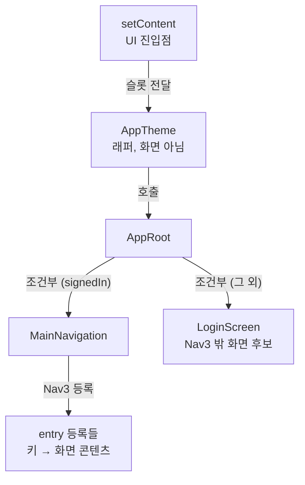

앱에 화면이 몇 개 있는지 코드만 보고 세어 본 적이 있다면, 생각보다 답이 안 나온다는 걸 알 것이다. 프로젝트에서 `Screen` 으로 끝나는 함수를 검색하면 숫자는 나온다. 그런데 그 안에는 화면이 아닌 것도 섞여 있고, 이름에 `Screen` 이 없는 화면은 빠진다. 어떤 화면이 실제로 어디에 등록돼 있는지는 함수 이름보다 호출 관계를 따라가야 보인다.

[1편](/posts/android-apm-1-why/)에서 android-apm이 화면 목록을 먼저 만들고 측정을 그 위에 붙인다고 했다. 이번 글은 그 목록을 어떻게 만드는지 다룬다. Kotlin 컴파일러의 FIR과 IR 중 어디서 코드를 읽는지, 왜 굳이 컴파일러 플러그인이어야 했는지, 그래도 모든 화면을 찾을 수는 없는 이유와 그걸 알면서 최대한 많이 찾으려고 정한 규칙을 순서대로 적는다.

웹에서 라우터 설정을 보고 페이지 목록을 뽑아 본 적이 있다면 같은 문제다. 안드로이드 이름이 나오는 자리에 자기가 쓰는 라우터를 넣고 읽어도 된다.

## 용어 몇 개만 맞추고 가자

1편에서 Composable(Compose에서 화면 조각을 그리는 함수)과 Nav3(화면 이동을 관리하는 Compose용 라이브러리)를 정의했다. 이번 글에는 컴파일러 쪽 용어가 더 나온다.

| 용어 | 이 글에서의 뜻 |
|---|---|
| 컴파일러 플러그인 | Kotlin 컴파일러가 코드를 컴파일하는 도중에 끼어들어 코드를 읽거나 바꾸는 확장 |
| FIR | K2 컴파일러의 앞단(frontend)이 쓰는 자료 구조. 이름이 무엇을 가리키는지, 어떤 함수를 부르는지, 타입이 무엇인지를 여기서 정한다 |
| IR | 앞단이 해석을 마친 뒤 만드는 중간 표현. 뒷단(backend)이 이걸 받아 바이트코드로 만든다 |
| lowering | IR을 바이트코드로 만들기 쉬운 단순한 형태로 바꿔 가는 단계. 람다나 인라인 함수가 이때 모양이 바뀐다 |
| 등록(entry) | Nav3에서 "이 키가 오면 이 화면을 그린다"고 적어 두는 코드 |
| UI 진입점 | Compose 화면 그리기가 시작되는 곳. Activity의 `setContent { }` 가 대표적이다 |
| 슬롯 | Composable이 다른 Composable을 인자로 받는 자리. `AppTheme { 내용 }` 의 `내용` 부분 |

## 화면 목록은 코드 어디에 있나

레포의 샘플 앱은 화면이 두 개다. 화면 목록이 코드에 어떻게 남는지 보기에는 이 정도면 충분하다.

```kotlin
class MainActivity : ComponentActivity() {
    override fun onCreate(savedInstanceState: Bundle?) {
        super.onCreate(savedInstanceState)
        setContent { SampleApp() }          // UI 진입점
    }
}

@Composable
fun SampleApp() {
    val backStack = remember { mutableStateListOf<Any>(Home) }
    NavDisplay(
        backStack = backStack,
        onBack = { backStack.removeLastOrNull() },
        entryProvider = entryProvider {
            entry<Home> { HomeScreen(onOpenDetail = { backStack.add(Detail) }) }   // 키 Home → HomeScreen
            entry<Detail> { DetailScreen() }                                       // 키 Detail → DetailScreen
        },
    )
}
```

"이 앱에는 Home과 Detail 두 화면이 있다"는 사실은 어디에도 목록으로 적혀 있지 않다. `setContent` 가 `SampleApp` 을 부르고, `SampleApp` 안의 `entry<Home>` 이 람다를 받고, 그 람다가 `HomeScreen` 을 부른다는 호출 관계를 따라가야 나온다. Nav3가 컴파일 결과로 화면 목록이나 내비게이션 그래프를 따로 만들어 주지도 않는다. 그러니 이 관계를 직접 읽어야 한다.

## 왜 컴파일러 플러그인이어야 했나

관계를 읽는 방법은 몇 가지 있다. 하나씩 따져 봤다.

앱을 실행하면서 뜨는 화면을 기록하는 방법은 가 본 화면만 남는다. 1편에서 말한 문제, 즉 사람이 기억하는 경로만 재게 되는 문제가 그대로 돌아온다. 실행 기록은 나중에 "실제로 떴는지"를 확인하는 데 쓰고, 목록의 출발점으로는 쓰지 않기로 했다.

소스를 텍스트로 검색하는 방법은 빠르지만 `entry` 라는 글자가 정말 Nav3의 등록 함수인지 알 수 없다. 같은 이름의 다른 함수일 수도 있고, 별칭으로 import했을 수도 있고, 보조 함수 안에 감춰져 있을 수도 있다. 위의 `HomeScreen` 을 화면이라고 판단할 근거도 이름밖에 없다.

[KSP](https://kotlinlang.org/docs/ksp-overview.html)는 어노테이션 기반 코드 생성에 많이 쓰는 도구다. 공식 문서에 "KSP는 선언과 타입 정보를 모델링하지만 표현식이나 함수 본문에는 접근하지 못한다"고 적혀 있다. 우리가 찾는 `entry<Home> { HomeScreen() }` 은 `SampleApp` 함수 본문 안의 람다에 들어 있다. KSP로는 거기까지 내려갈 수 없다.

컴파일러 플러그인은 컴파일러가 이름과 호출을 다 해석한 뒤의 결과를 받는다. `entry` 가 어느 라이브러리의 어떤 오버로드인지 심볼로 확인할 수 있고, 함수 본문과 람다도 그대로 들어 있다. 실제 빌드와 같은 입력을 본다는 점도 크다. 선택한 variant, 자동 생성된 소스, 클래스패스가 실제 컴파일과 같다. 그리고 1편에서 말한 함수 호출 계측은 결국 컴파일된 코드에 측정 코드를 넣는 일이라, 언젠가는 컴파일러 플러그인이 필요하다. 화면 수집을 같은 자리에서 시작하면 기반을 한 번만 만들면 된다.

Gradle 플러그인도 함께 필요하다. Kotlin 컴파일러 플러그인은 혼자서는 빌드에 붙지 않는다. 어떤 variant의 어떤 컴파일에 플러그인 JAR과 옵션을 넘길지는 Gradle 쪽에서 정한다. 사용자가 `build.gradle.kts` 에 한 줄 추가하면 나머지 연결을 Gradle 플러그인이 맡는다.

## FIR과 IR, 어느 쪽에서 읽을까

[Kotlin 공식 문서](https://kotlinlang.org/docs/custom-compiler-plugins.html)는 컴파일 과정을 다섯 단계로 나눈다. 파싱, 분석과 해석, IR 생성, IR lowering, 코드 생성이다. 플러그인이 끼어들 수 있는 곳은 크게 둘이다.

앞단(FIR)은 [K2 컴파일러](https://kotlinlang.org/docs/k2-compiler-migration-guide.html)가 새로 만든 부분이다. 의미 분석, 호출 해석, 타입 추론을 하나의 자료 구조 위에서 한다. 앞단 플러그인은 컴파일러가 코드를 해석하는 방식 자체를 바꾼다. 문서에 나온 예가 어노테이션 추가, 본문 없는 메서드 추가, 가시성 변경이고, 이런 변경은 IDE에서도 보인다. 확장점도 선언 생성(`FirDeclarationGenerationExtension`), 추가 검사기(`FirAdditionalCheckersExtension`)처럼 해석 과정에 참여하는 용도로 짜여 있다.

뒷단(IR)은 해석이 끝난 뒤다. 확장점이 `IrGenerationExtension` 하나뿐이고, `generate()` 를 구현하면 모듈 하나의 IR 트리 전체를 받는다. 문서는 이 단계를 선언의 동작을 바꾸는 곳, 예를 들어 선언에 본문을 채워 넣는 곳으로 설명한다. 변경은 컴파일된 결과물에만 나타나고 IDE에는 보이지 않는다.

화면 수집에 필요한 건 해석이 끝난 결과를 모듈 단위로 한 번에 훑으면서 호출, 람다, 타입 관계를 뽑아내는 일이다. FIR에도 해석 결과는 있지만, 그 확장점들은 해석 과정 중간에 개입하도록 만들어져 있다. IR의 `generate()` 는 다 끝난 트리를 통째로 넘겨주니 읽기만 하는 수집기의 진입점으로 단순하다. 나중에 측정 코드를 넣는 일도 뒷단에서 하게 되므로 같은 확장점을 계속 쓸 수 있다.

<iframe src="/assets/diagrams/2026-10-13-android-apm-2-screen-discovery.html"
        title="화면 수집 구조 다이어그램: Kotlin 컴파일러의 FIR, IR, lowering 단계 중 IR 단계에서 플러그인이 세 가지 수집기를 돌려 모듈별 목록을 만들고, 프로젝트 병합 후 화면·상태·미해결로 분류한다"
        loading="lazy" width="100%" height="880"
        style="border:1px solid var(--main-border-color); border-radius:6px;"></iframe>

> 잘려 보이면 [전체 화면으로 열기](/assets/diagrams/2026-10-13-android-apm-2-screen-discovery.html).
{: .prompt-tip }

지금 레포에 있는 코드는 이 연결이 실제로 동작하는지 확인하는 수준이다. [ApmIrProbe.kt](https://github.com/android-apm-tool/android-apm/blob/3dcb13ac8848b8fa2b3d0d50a6e27ff97eac3743/apm-compiler-plugin/src/main/kotlin/dev/androidapm/compiler/ApmIrProbe.kt)는 IR 트리를 돌면서 `@Composable` 이 붙은 함수 이름만 모은다. 아래는 파일을 쓰는 뒷부분을 줄이고 주석을 우리말로 옮긴 것이다.

```kotlin
internal class ApmIrProbe(
    private val messages: MessageCollector,
    private val reportFile: File? = null,
) : IrGenerationExtension {
    override fun generate(moduleFragment: IrModuleFragment, pluginContext: IrPluginContext) {
        val composables = sortedSetOf<String>()
        moduleFragment.acceptChildrenVoid(object : IrVisitorVoid() {
            override fun visitElement(element: IrElement) = element.acceptChildrenVoid(this)

            override fun visitSimpleFunction(declaration: IrSimpleFunction) {
                if (declaration.hasAnnotation(FqName("androidx.compose.runtime.Composable"))) {
                    composables += declaration.fqNameWhenAvailable?.asString() ?: declaration.name.asString()
                }
                super.visitSimpleFunction(declaration)
            }
        })
        // 이번 호출에서 본 파일만의 스냅샷이다. 증분 컴파일이면 일부 파일만 들어온다.
        // ... 결과를 보고 파일에 쓴다
    }
}
```

샘플 앱에서 돌리면 `SampleApp`, `HomeScreen`, `DetailScreen` 이 찍힌다. 다만 Compose가 만들어 낸 람다도 같이 나온다. Compose 컴파일러도 플러그인이고 같은 IR을 다루기 때문에, 우리 수집기가 어느 시점의 IR을 보는지가 결과를 바꾼다. 수집은 lowering이 등록 코드의 모양을 바꾸기 전을 목표로 하지만, 다른 플러그인과의 실행 순서는 가정하지 않고 테스트로 확인하기로 했다.

> 공식 문서는 컴파일러 플러그인 API가 불안정하고 릴리스마다 호환되지 않는 변경이 들어간다고 경고한다. 그래서 지원하는 Kotlin 버전을 고정하고(지금은 2.3.21), 처음 보는 버전에서는 빈 목록을 내지 않고 호환성 진단을 남기기로 했다.
{: .prompt-warning }

## 그래도 모든 화면을 찾을 수는 없다

IR이 아무리 많은 걸 담고 있어도 컴파일러가 아는 것 이상은 알 수 없다. 설계하면서 확인한 한계는 이렇다.

| 경우 | 왜 못 찾나 | 예 |
|---|---|---|
| 실행해야 정해지는 값 | 조건을 계산하지 않는다 | 서버 플래그, 조립한 키 |
| 코드에 없는 화면 | 구조가 서버 데이터에 있다 | SDUI |
| 못 보는 코드 | 이번 컴파일 입력이 아니다 | AAR 안의 화면, 다른 variant |
| 간접 호출 | 대상이 실행 시점에 정해진다 | 인터페이스, 리플렉션, DI |
| 화면의 경계가 애매함 | 화면·상태·부품 구분이 코드에 없다 | 테마 래퍼, 카드 겸용 함수 |
| 지원 밖 탐색 방식 | 첫 구현은 Compose + Nav3만 | XML 내비게이션, Fragment |

SDUI는 서버가 내려주는 데이터로 화면을 조립하는 방식이고, AAR은 미리 빌드해 둔 안드로이드 라이브러리 파일이다. 마지막 두 줄은 성격이 조금 다르다. 앞의 넷은 정적 분석이 원리상 못 하는 일이고, 화면 판정이 애매한 건 기준을 정해야 하는 문제고, 탐색 방식은 범위를 아직 안 넓힌 것이다.

"원리상"이라고 쓴 데는 근거가 있다. 이 문제는 1936년에 앨런 튜링이 이미 풀어 뒀다. 풀 수 없다는 쪽으로. [정지 문제](https://ko.wikipedia.org/wiki/%EC%A0%95%EC%A7%80_%EB%AC%B8%EC%A0%9C)는 아무 프로그램이나 받아서 그게 언젠가 멈추는지 판정해 주는 알고리즘은 존재할 수 없다는 증명이다. 화면 수집기에 옮기면 이런 코드가 된다.

```kotlin
entryProvider {
    entry<Home> { HomeScreen() }

    if (thisLoopEventuallyEnds(input)) {
        // 이 화면이 실제로 등록되는지 확실히 알려면 위 함수가 끝나는지부터 알아야 한다.
        // 그걸 알아내는 수집기를 만들면 튜링이 틀렸다는 뜻이니, 블로그 말고 논문을 써야 한다
        entry<Secret> { SecretScreen() }
    }
}
```

[라이스 정리](https://en.wikipedia.org/wiki/Rice%27s_theorem)는 여기서 한 걸음 더 나간다. "이 코드가 실행되는가", "이 화면이 언젠가 뜨는가"처럼 프로그램이 실제로 하는 일에 관한 성질은 일반적으로 다 판정할 수 없다. 그러니 "실제로 뜰 수 있는 화면만 정확히 골라내는 도구"를 만들었다는 사람을 만나면, 먼저 정지 문제를 어떻게 피했는지부터 물어보면 된다.

그래서 수집기는 한발 물러서서 "등록될 수 있는 자리"를 전부 모은다. 조건을 계산하지 않고 두 분기를 다 남기는 게 그 방법이다. 이러면 실제로는 한 번도 안 뜰지 모르는 `SecretScreen` 도 후보에 들어오는데, 그건 나중에 실행 기록과 사람 검토가 걸러 낸다. 1편에서 말한 99% 목표가 "실제로 뜨는 화면"이 아니라 "코드에 정의된 화면"을 기준으로 잡혀 있는 것도 이 때문이다. 도달할 수 있는지는 따로 표시한다.

빌드 방식에서 오는 한계도 하나 있다. Kotlin은 [증분 컴파일](https://kotlinlang.org/docs/gradle-compilation-and-caches.html)을 하기 때문에 파일 하나를 고치면 그 파일과 영향받은 파일만 다시 컴파일한다. 이때 IR 콜백에 들어오는 건 모듈의 일부다. 지금 probe 결과도 마지막 컴파일 한 번의 스냅샷이라, 이걸 모듈 전체 목록으로 쓰면 고치지 않은 파일의 화면이 사라진다.

## 그래서 최대한 찾으려고 정한 것들

못 찾는 경우가 있다는 걸 전제로, 찾을 수 있는 건 빠짐없이 찾고 못 찾은 건 숨기지 않는 쪽으로 설계했다.

### 세 갈래로 동시에 모은다

한 경로만 따라가면 그 경로에서 벗어난 화면을 놓친다. 그래서 세 가지를 따로 모은 뒤 합친다.

1. 전체 선언: 분석 대상 소스와 생성 소스의 모든 Composable 함수, 람다, 함수 참조를 모은다. 어디에서도 호출되지 않는 선언도 이 단계에서는 버리지 않는다.
2. UI 진입점: MainActivity 하나에 그치지 않고 모든 모듈에서 `setContent`, `ComposeView.setContent`, `AbstractComposeView.Content` 를 찾는다. 프레임워크가 호출하는 [`AbstractComposeView.Content`](https://developer.android.com/reference/kotlin/androidx/compose/ui/platform/AbstractComposeView)처럼 앱 코드에 직접 호출이 없는 메서드도 시작점 후보로 넣는다.
3. Nav3 등록: `entry<T>`, 키 기반 등록, 등록 보조 함수, 람다로 직접 만든 provider, fallback까지 본다. Nav3는 DSL과 직접 provider 두 방식을 모두 제공하므로([Nav3 기본](https://developer.android.com/guide/navigation/navigation-3/basics)) DSL만 찾고 끝내지 않는다.

`entry` 는 해석된 심볼로 확인한다. 소속 타입, receiver, 시그니처, 라이브러리 출처가 Nav3의 것과 맞아야 등록으로 인정한다.

### 직접 호출 말고 콘텐츠가 넘어가는 길을 따라간다

Compose에서는 화면이 함수 호출로만 이어지지 않는다. 슬롯으로 넘어가고, 함수 참조로 넘어가고, 일반 함수가 람다를 반환해서 넘어가기도 한다. 이런 전달을 모두 따라가고, `if` 와 `when` 은 실행하지 않고 모든 분기를 수집한다.

```kotlin
setContent {
    AppTheme {                      // 래퍼: 내용을 슬롯으로 받을 뿐 화면이 아니다
        AppRoot()
    }
}

@Composable
fun AppRoot() {
    if (signedIn) MainNavigation()  // 조건은 계산하지 않고 두 분기를 다 수집
    else LoginScreen()              // Nav3 밖에 있는 화면 후보
}
```

이 코드에서 수집기가 남기는 관계를 그리면 이렇다.



`AppTheme` 은 따라가되 화면으로 세지 않는다. `LoginScreen` 은 Nav3에 등록돼 있지 않아도 화면 후보로 남는다. 그리고 이 그림의 화살표는 UI 구성 관계일 뿐이다. 화면 사이 이동 경로는 버튼 클릭과 상태 변경을 따로 분석해서 만든다.

### 보조 함수와 DI를 거쳐도 연결한다

규모가 큰 앱은 등록을 모듈별 보조 함수로 나누고, DI로 모아서 한꺼번에 적용하기도 한다([Nav3 모듈화](https://developer.android.com/guide/navigation/navigation-3/modularize)). 설계 문서의 예시를 그대로 가져오면 이런 모양이다.

```kotlin
fun EntryProviderScope<NavKey>.productEntries(enableReviews: Boolean) {
    entry<Product> { key -> ProductScreen(key.productId) }

    if (enableReviews) {
        entry<Reviews> { key -> ReviewsScreen(key.productId) }
    }
}

val provider = entryProvider<NavKey> {
    productEntries(enableReviews = featureFlags.reviews)
}
```

`productEntries` 안의 등록을 먼저 수집하고, 호출하는 쪽에서 provider에 연결한다. `Reviews` 는 "보조 함수가 호출되고 인자가 참일 때"라는 조건과 함께 남긴다. 같은 보조 함수를 provider 두 곳에서 쓰면 선언은 하나로 두고 연결은 따로 만든다. 제네릭 래퍼 안의 `entry<T>` 는 `T` 를 그대로 들고 있다가 호출하는 쪽의 타입 인자로 바꾼다. DI는 라이브러리마다 모으는 방식이 달라서 지원하는 라이브러리를 어댑터로 하나씩 명시한다.

### 화면 판정은 쓰이는 자리를 기준으로 한다

같은 Composable이 어떤 키의 목적지 콘텐츠이면서 다른 화면 안의 카드일 수 있다. 그래서 분류를 함수에 붙이지 않고 사용 맥락마다 붙인다. 이름에 `Screen` 이 있는지는 참고만 하고 판정 근거로 쓰지 않는다. 같은 화면 안의 로딩·오류 분기는 그 화면의 상태로 분류하고 새 화면으로 세지 않는다.

### 모듈 전체를 따로 한 번 컴파일한다

증분 컴파일의 스냅샷 문제를 피하려고, 일반 빌드는 그대로 두고 수집용 컴파일을 모듈마다 따로 돌리는 방식을 기본으로 잡았다. 같은 variant의 소스, 생성 소스, 클래스패스, 컴파일러 설정을 그대로 써야 한다. 공개된 빌드 API로 이걸 재현할 수 있는지가 다음 PoC의 첫 번째 확인 사항이다. 결과는 [Gradle 작업 출력](https://docs.gradle.org/current/userguide/incremental_build.html)으로 등록해서 캐시가 맞으면 다시 컴파일하지 않는다. 컴파일이 실패하면 이전 결과를 새 결과처럼 내놓지 않는다.

### 못 푼 건 이유와 함께 남긴다

연결을 못 풀었다고 선언을 지우지 않는다. 모듈별 목록에 진단 코드를 같이 적는다. 아래는 설계 문서의 형식 예시를 줄이고, 진단 칸에 어떤 내용이 들어가는지 보이려고 몇 개를 채워 넣은 것이다. 진단 항목의 세부 필드는 아직 정하지 않았다.

```json
{
  "moduleId": ":feature:product",
  "variant": "debug",
  "collectionStatus": "COMPLETE_FOR_DECLARED_INPUTS",
  "resolutionStatus": "PARTIAL",
  "screenCandidates": [],
  "diagnostics": [
    { "code": "UNRESOLVED_KEY_VALUE", "note": "키 값이 실행 시점에 정해짐" },
    { "code": "EXTERNAL_MODULE_NO_CATALOG", "note": "의존 라이브러리 내부를 분석하지 못함" },
    { "code": "UNCLASSIFIED_UI_CONTENT", "note": "화면인지 부품인지 판정 못 함" }
  ]
}
```

`COMPLETE_FOR_DECLARED_INPUTS` 는 "받은 입력을 끝까지 훑었다"는 뜻이고, 화면을 다 찾았다는 보장은 들어 있지 않다. 대시보드는 이 미해결 항목을 근거와 함께 따로 보여주고, 사람이 검토할 수 있게 한다.

이렇게 남긴 후보는 나중에 실행 관측이 보완한다. 정적으로는 "등록돼 있을 수 있다"까지만 아는 화면이 실제 기기에서 떴는지, 어떤 키 값으로 떴는지를 기록이 채운다.

### 얼마나 찾았는지 따로 잰다

목표는 정답 목록을 사람이 미리 만든 평가용 프로젝트들에서 화면 정의의 99% 이상을 찾는 것이다(SDUI 제외). 화면을 찾은 비율, 화면이 아닌 걸 화면으로 잘못 센 비율, 연결을 푼 비율은 따로 계산한다. 아직 수집기가 없어서 한 번도 재지 않았다. 정답 목록이 없는 사용자 프로젝트에는 추정한 발견률 대신 분석한 범위와 미해결 건수를 보여준다.

## 이 방법이 통하는 조건

컴파일러에서 관계를 읽고 못 푼 것을 남기는 방식은 Android 화면 찾기 밖에서도 쓸 수 있다. 이런 조건이면 같은 처방이 듣는다.

- 찾으려는 대상이 코드에 선언으로 남는다. 라우트 등록, 핸들러 등록, 플러그인 등록처럼 "이 키에 이 처리"를 적는 코드라면 해당된다.
- 이름 규칙만으로 대상을 가려낼 수 없어서 해석된 호출 관계가 필요하다.
- 분석을 실제 빌드와 같은 입력으로 돌릴 수 있다. 빌드 설정이 분석 결과를 바꾸는 프로젝트일수록 별도 도구보다 컴파일러 안에서 읽는 편이 맞다.
- 놓친 것을 사용자에게 보여줄 자리가 있다. 미해결 목록을 볼 곳이 없으면 못 찾은 화면은 그냥 없는 화면이 된다.

## 다음 편

지금 있는 건 IR까지 연결이 닿는다는 확인뿐이다. 다음은 수집용 컴파일 PoC를 만들고 샘플 앱에서 세 갈래 수집 결과를 실제 목록으로 뽑아 보는 일이다. 그 결과는 [3편](/posts/android-apm-3-catalog/)에 적었다.

## 참고 자료

- [android-apm-tool/android-apm](https://github.com/android-apm-tool/android-apm): 이 시리즈의 레포
- [설계 문서: IR 기반 화면 발견과 Nav3 연결](https://github.com/android-apm-tool/android-apm/blob/3dcb13ac8848b8fa2b3d0d50a6e27ff97eac3743/docs/03-nav3-entry-discovery.md)
- [Kotlin: Custom compiler plugins](https://kotlinlang.org/docs/custom-compiler-plugins.html)
- [Kotlin: K2 compiler migration guide](https://kotlinlang.org/docs/k2-compiler-migration-guide.html)
- [Kotlin: KSP overview](https://kotlinlang.org/docs/ksp-overview.html)
- [Kotlin: Compilation and caches in the Kotlin Gradle plugin](https://kotlinlang.org/docs/gradle-compilation-and-caches.html)
- [Compose compiler](https://developer.android.com/develop/ui/compose/compiler)
- [Navigation 3 basics](https://developer.android.com/guide/navigation/navigation-3/basics)
- [Navigation 3 modularization](https://developer.android.com/guide/navigation/navigation-3/modularize)
- [Using Compose in Views](https://developer.android.com/develop/ui/compose/migrate/interoperability-apis/compose-in-views)
- [AbstractComposeView](https://developer.android.com/reference/kotlin/androidx/compose/ui/platform/AbstractComposeView)
- [Gradle: Incremental build](https://docs.gradle.org/current/userguide/incremental_build.html)
- [정지 문제 (위키백과)](https://ko.wikipedia.org/wiki/%EC%A0%95%EC%A7%80_%EB%AC%B8%EC%A0%9C)
- [Rice's theorem (Wikipedia)](https://en.wikipedia.org/wiki/Rice%27s_theorem)
