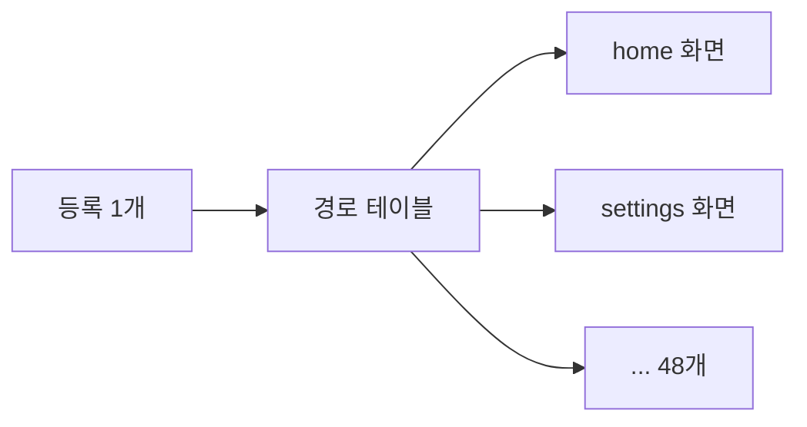

빌드에 분석 도구를 붙여 본 적이 있다면 세 가지 걱정을 해 봤을 것이다. 결과가 프로젝트 전체를 다 본 결과인지, 그 도구 때문에 평소 빌드가 느려지거나 깨지지는 않는지, 도구가 중간에 실패하면 무엇이 남는지. 린트든 테스트 커버리지든 의존성 그래프든 같은 걱정이다.

[2편](/posts/android-apm-2-screen-discovery/)에서는 Kotlin 컴파일러 안에서 화면을 찾는 방법을 설계로만 적었다. 오늘 레포에 그 설계를 구현한 [PR #4](https://github.com/android-apm-tool/android-apm/pull/4)가 들어갔다. 이번 글은 구현하면서 위의 세 걱정에 각각 어떻게 답했는지, 그리고 실제 앱 하나(37개 모듈)에 돌려서 나온 숫자를 어디까지 믿어도 되는지를 적는다. 안드로이드를 몰라도 "빌드 중에 정보를 뽑아 파일로 남기는 도구"라고 생각하고 읽으면 된다.

## 용어 몇 개만 더

2편의 용어(IR, 등록, UI 진입점, 슬롯)는 그대로 쓴다. 이번에는 빌드 쪽 용어가 추가된다.

| 용어 | 이 글에서의 뜻 |
|---|---|
| 카탈로그 | 이 도구가 뽑아내는 화면 목록 파일. JSON이다 |
| 증분 컴파일 | 지난 빌드 이후 바뀐 파일만 다시 컴파일하는 방식. 평소 빌드가 빠른 이유다 |
| 모듈 | 큰 앱을 나눠 둔 하위 프로젝트. 모듈마다 따로 컴파일된다 |
| UP-TO-DATE / FROM-CACHE | Gradle이 작업을 건너뛰는 두 경우. 입력이 그대로라 이전 결과를 쓰거나, 캐시에서 결과를 꺼내 온다 |
| 원자적 교체 | 파일을 다 쓴 뒤 한 번에 바꿔치기해서, 읽는 쪽이 반만 쓰인 파일을 보지 않게 하는 방법 |

## 전체 흐름

<iframe src="/assets/diagrams/2026-10-13-android-apm-3-catalog.html"
        title="앱 컴파일 설정을 빌려 수집용 전체 컴파일을 하고, 모듈 원본을 요약해 보고서를 만들거나 하위 모듈 원본과 병합해 프로젝트 보고서를 만드는 흐름"
        loading="lazy" width="100%" height="720"
        style="border:1px solid var(--main-border-color); border-radius:6px;"></iframe>

> 잘려 보이면 [전체 화면으로 열기](/assets/diagrams/2026-10-13-android-apm-3-catalog.html).
{: .prompt-tip }

Gradle 작업은 세 개다. `apmCompileDebugCatalog` 가 수집용 컴파일을 하고, `apmCollectDebugCatalog` 가 그 결과를 모듈 카탈로그로 내놓고, `apmMergeDebugCatalog` 가 앱이 의존하는 모듈들의 카탈로그를 모아 하나로 잇는다. 사용자는 마지막 것만 실행하면 된다.

```bash
./gradlew :app:apmMergeDebugCatalog
# → app/build/reports/android-apm/catalog/debug/project-catalog.json
```

## 걱정 1: 결과가 전체를 본 결과인가

2편 끝에서 "증분 스냅샷을 목록으로 쓰지 않는다"고 적었다. 구현해 보니 이유가 더 분명해졌다. 컴파일러 플러그인은 컴파일러가 넘겨주는 코드만 본다. 증분 컴파일에서 컴파일러가 넘겨주는 건 이번에 바뀐 파일뿐이다. 마지막 컴파일에서 받은 결과를 저장하면, 어제 수정한 파일 하나짜리 화면 목록이 나온다. 지워진 화면이 목록에 남아 있는지도 알 수 없다.

그래서 수집용 컴파일을 따로 만들었다. 앱의 원래 Kotlin 컴파일 작업에서 소스, 의존성, 컴파일러 옵션, 다른 플러그인 설정을 그대로 가져오고 증분 컴파일만 끈다. 출력도 별도 폴더에 쓴다. 앱의 평소 빌드 설정은 하나도 바꾸지 않는다. [CatalogTasks.kt](https://github.com/android-apm-tool/android-apm/blob/1cd3dd2981f7f52e3eb0e3f2736c07437e7cb66f/apm-gradle-plugin/src/main/kotlin/dev/androidapm/gradle/CatalogTasks.kt)에서 핵심만 줄이면 이렇다.

```kotlin
val original = project.tasks.findByName("compileDebugKotlin") as KotlinJvmCompile
val collector = factory.registerKotlinJvmCompileTask("apmCompileDebugCatalog", original.compilerOptions)
collector.configure { task ->
    task.source(original.sources)                       // KSP 같은 코드 생성 결과도 함께 따라온다
    task.libraries.from(original.libraries)
    task.friendPaths.from(original.friendPaths)         // internal 선언을 볼 수 있게
    task.pluginClasspath.from(original.pluginClasspath, compiler)
    task.destinationDirectory.set(layout.buildDirectory.dir("intermediates/android-apm/debug/classes"))
    (task as KotlinCompile).incremental = false         // 이 작업에서만 증분을 끈다
    task.compilerOptions.freeCompilerArgs.set(original.compilerOptions.freeCompilerArgs.map { args ->
        // Compose 컴파일러 플러그인보다 먼저 실행해야 람다와 슬롯이 원래 모양으로 남아 있다
        args + "-Xcompiler-plugin-order=dev.androidapm.compiler>androidx.compose.compiler.plugins.kotlin"
    })
}
```

마지막 줄이 2편에서 말한 lowering 문제의 해답이다. Compose 컴파일러 플러그인도 IR 단계에서 코드를 고친다. 그 뒤에 읽으면 `entry<Home> { HomeScreen() }` 의 람다가 이미 다른 모양으로 바뀌어 있다. 플러그인 실행 순서를 지정해서 Compose가 손대기 전의 IR을 읽는다.

이 방식에는 비용이 있다. 수집할 때마다 모듈 전체를 처음부터 컴파일한다. 다만 평소 개발 빌드에는 끼지 않고, 사람이 화면 목록이 필요할 때 명시적으로 실행하는 작업이라 감당할 만하다고 봤다. 입력이 그대로면 Gradle이 작업을 건너뛰기 때문에 두 번째부터는 공짜에 가깝다.

"전체를 봤다"는 말을 결과 파일에 어떻게 적을지도 정해야 했다. 카탈로그의 `collectionStatus` 값은 `COMPLETE_FOR_DECLARED_INPUTS` 하나뿐이다. "지정된 입력 파일을 끝까지 다 돌았다"는 뜻이다. 모든 화면을 찾았다는 뜻으로 읽으면 안 된다. 그건 2편에서 튜링이 이미 안 된다고 했다. 대신 연결이 다 풀렸는지는 `resolutionStatus` 에 `RESOLVED` 나 `PARTIAL` 로 따로 적는다.

## 걱정 2: 결과 파일을 사람이 읽을 수 있나

처음 구현은 수집한 사실을 전부 JSON 하나에 담았다. 함수, 변수, 호출 관계, 분기 조건까지 다 들어간다. 모듈을 이어 붙이려면 이 사실이 다 필요하다. A 모듈의 등록 코드가 B 모듈의 함수를 부르고, 그 함수가 C 모듈의 화면을 부르는 식으로 연결되기 때문이다.

문제는 크기였다. 37개 모듈짜리 앱에서 병합 결과가 134,222,027바이트, 약 134MB가 나왔다. 화면 목록을 보려고 연 파일이 에디터를 멈추게 만들면 목록으로서 쓸모가 없다.

그래서 파일을 둘로 나눴다.

| 파일 | 담는 것 | 누가 읽나 |
|---|---|---|
| 내부 원본 (v1) | 함수·값·호출·조건·DI 선언 등 수집한 사실 전부 | 병합 작업만 |
| 공개 보고서 (v2) | 화면 후보, 등록과 진입점 연결, 참조한 Composable, 소스 위치, 진단 | 사람과 대시보드 |

병합 작업은 항상 원본을 읽는다. 보고서는 거기서 만들어지는 요약이라 다시 병합 입력으로 쓰지 않는다. 요약을 줄이다가 다음 병합에 필요한 근거를 지워 버리는 사고를 구조로 막아 둔 셈이다. 보고서 쪽은 Composable 정의를 한 번만 적고 나머지는 ID로 참조하게 하고, 소스 위치는 상대 경로와 줄 번호만 남겼다. 같은 37개 모듈 결과가 343,633바이트가 됐다. 99.744% 줄었다.

샘플 앱으로 직접 돌려 봤다. 원본이 77,813바이트, 보고서가 4,249바이트다. 보고서에서 Home 등록 하나를 떼어 오면 이렇다.

```json
{
  "id": "28f07b56f8086ca6d351e065eb773d7c:93418775a86c8f5072cc3ad68070c65a:REGISTRATION:44136fa355b3678a",
  "source": { "path": "app/src/main/kotlin/dev/androidapm/sample/MainActivity.kt", "line": 34 },
  "providerId": "28f07b56f8086ca6d351e065eb773d7c",
  "context": "REGISTRATION",
  "classification": "NAV3_DESTINATION_CONTENT",
  "resolution": "RESOLVED",
  "keyCandidates": [{ "kind": "TYPE", "type": "dev.androidapm.sample.Home" }],
  "contentCalls": ["dev.androidapm.sample.HomeScreen"],
  "composableIds": ["f4dfc890dd310f7323c5971166cf252c", "3092daf6fba46d55f1558a6075b42a2c"]
}
```

`MainActivity.kt` 34번째 줄에 `Home` 키로 등록된 내용이 있고, 그 내용은 `HomeScreen` 을 부른다. `composableIds` 의 두 ID는 아래쪽 `composables` 목록에서 `HomeScreen` 과 그 안의 `BasicText` 로 풀린다.

여기서 `contentCalls` 의 첫 항목을 곧바로 화면 이름으로 쓰지 않기로 했다. 실제 앱에서는 등록 람다가 `AppScaffold { HomeScreen() }` 처럼 바깥 틀부터 부르는 경우가 흔하다. 첫 함수를 화면이라고 하면 모든 화면 이름이 `AppScaffold` 가 된다. 그래서 등록된 내용은 `NAV3_DESTINATION_CONTENT`(등록된 화면 내용의 경계)로만 표시하고, 그 안의 어느 함수가 화면인지는 아직 정하지 않는다. 이걸 정하는 분류기는 다음 단계다.

## 걱정 3: 실패하면 무엇이 남나

수집용 컴파일은 사용자 코드를 컴파일하는 일이라 실패할 수 있다. 실패했을 때 반쯤 쓰인 카탈로그가 남으면, 대시보드는 그걸 정상 결과로 읽고 화면 절반이 사라졌다고 보여 줄 것이다. 빌드가 빨간불로 끝나는 쪽이 차라리 낫다.

규칙은 두 개로 정했다. 컴파일이 성공해야 공개 작업이 실행된다. 그리고 공개 파일은 임시 파일에 다 쓴 뒤 한 번에 바꿔치기한다.

```kotlin
private fun writeCatalog(output: File, catalog: Record, pretty: Boolean = false) {
    // 읽는 쪽이 반만 쓰인 결과를 보지 않도록 원자적으로 교체한다
    output.parentFile.mkdirs()
    val temporary = Files.createTempFile(output.parentFile.toPath(), "catalog-", ".json")
    try {
        Files.newBufferedWriter(temporary, Charsets.UTF_8).use { Json.write(catalog, it, pretty); it.append('\n') }
        try { Files.move(temporary, output.toPath(), ATOMIC_MOVE, REPLACE_EXISTING) }
        catch (_: AtomicMoveNotSupportedException) { Files.move(temporary, output.toPath(), REPLACE_EXISTING) }
    } finally { Files.deleteIfExists(temporary) }
}
```

임시 파일을 결과 파일과 같은 폴더에 만든다. [`Files.move`](https://docs.oracle.com/en/java/javase/17/docs/api/java.base/java/nio/file/Files.html)의 `ATOMIC_MOVE` 는 파일 시스템이 원자적 이동을 지원할 때만 되는데, 다른 디스크로 옮기는 경우가 대표적으로 안 되는 경우다. 그래도 안 되면 일반 이동으로 물러난다. 컴파일이 실패하면 마지막 성공 보고서가 그대로 남는다. 레포 문서에는 "그 파일을 이번 실행의 새 결과로 취급하면 안 된다"는 경고도 같이 적어 두었다. 파일이 있다는 것과 이번 실행이 성공했다는 건 다른 정보다.

캐시도 같은 맥락이다. 결과에 타임스탬프나 절대 경로를 넣지 않고 출력 순서를 고정해서, 같은 입력이면 같은 바이트가 나오게 했다. 그래야 [Gradle 빌드 캐시](https://docs.gradle.org/current/userguide/build_cache.html)가 결과를 재사용할 수 있다. 샘플에서 두 번째로 돌리면 세 작업이 전부 `UP-TO-DATE` 로 끝났고 빌드는 0.6초 걸렸다. 37개 모듈 앱에서도 카탈로그 작업 75개가 `UP-TO-DATE` 였고 결과 JSON의 SHA-256이 같았다. 소스 파일을 지우거나 등록이 0개가 되는 경우에는 이전 목록을 덮어쓰는 대신 전체를 새로 만든 목록으로 교체해서, 지운 화면이 남아 있지 않게 했다.

## 실제 앱에 돌려 보니

샘플은 화면 두 개라 뭐든 잘 된다. 그래서 내가 따로 만들고 있는 앱인 룰업에 로컬로 적용해 봤다. 앱 소스나 설정 파일은 고치지 않았다. 검증 스크립트가 빌드 스크립트에 플러그인을 임시로 끼웠다가 끝나면 원래 바이트로 되돌린다.

| 항목 | 결과 |
|---|---|
| 모듈 / Kotlin 소스 파일 | 37 / 687 |
| 수집한 Composable 선언 | 690 |
| 보고서가 참조한 함수 | 759 (외부 라이브러리 포함) |
| Nav3 등록 / 경로 후보 | 1 / 48 |
| UI 진입점 / 화면 전환 컨테이너 | 1 / 1 |
| 연결 상태 | `PARTIAL` |
| 진단 | 96개 (분석 한도 89, 동적 후보 2, 콘텐츠 흐름 미해결 4, 외부 슬롯 미해결 1) |

숫자 세 개에 설명이 필요하다.

먼저 Nav3 등록이 1개다. 화면이 하나뿐이라는 뜻은 아니다. 이 앱은 등록을 한 곳에서만 하고, 그 안에서 경로 테이블을 찾아 화면을 그리는 구조다. 설명용으로 단순화하면 이런 모양이다.

```kotlin
// 설명용으로 단순화한 모양이다. 실제 앱 코드가 아니다.
class Route(val path: String, val render: @Composable () -> Unit)

val routes = listOf(
    Route("home") { HomeScreen() },
    Route("settings") { SettingsScreen() },
    // ... 이런 줄이 48개
)

entryProvider {
    entry<GenericNavKey> { key -> routes.first { it.path == key.path }.render() }
}
```



등록만 세면 1개고, 경로 테이블의 `render` 를 따라가면 후보가 48개 나온다. 2편에서 "콘텐츠 전달을 따라간다"고 했던 규칙이 실제로 쓰인 경우다. 다만 키가 실행 중에 정해지므로 어떤 키일 때 어느 줄이 선택되는지까지는 확정하지 않는다. 후보 48개는 전부 `UNCLASSIFIED` 로 남고, 이런 미해결 연결이 있어서 전체 연결 상태도 `PARTIAL` 이다.

다음은 진단 96개 중 89개가 분석 한도다. 함수 흐름 깊이 40, 순회 단계 5,000, 표현식 깊이 24를 넘으면 더 따라가지 않고 `ANALYSIS_LIMIT_REACHED` 를 남긴다. 2편의 정지 문제 이야기와 이어지는 부분이다. 끝까지 따라갈 수 있다는 보장이 없으니 어딘가에서 멈춰야 하고, 멈췄다는 사실은 숨기지 않고 남긴다. 89개가 많아 보이지만 어디서 멈췄는지 소스 위치가 같이 남아서 한도를 조정할지, 패턴을 하나 더 지원할지 판단할 근거가 된다.

마지막이 48이라는 숫자 자체다. 이 앱의 최종 디자인 파일에는 최상위 프레임이 124개 있다. 48 / 124 = 39%라고 계산하고 싶어지지만 그러면 안 된다. 124개에는 온보딩 단계 3장, 상세 화면의 탭들, 빈 상태, 시트와 다이얼로그, 웹 화면, 스토어 이미지가 섞여 있다. 온보딩 3장은 경로 하나 안에서 넘어가고, 앱스토어 이미지는 애초에 코드에 없다. 둘은 세는 단위가 다르다.

1편에서 잡은 목표는 "화면 정의 발견률 99%"였다. 이걸 측정하려면 무엇을 화면 하나로 셀지부터 정해야 한다. 기본 화면, 탭, 시트·다이얼로그, 화면 상태, 코드 밖 산출물로 나눠 정답 목록을 먼저 만들고, 그다음에 수집 결과와 맞춰 보기로 했다. 아직 그 정답 목록도 분류기도 없다. 그래서 지금은 48을 "코드에 등록된 경로 후보 수"로만 쓴다.

## 이 방법이 통하는 조건

화면 목록이 아니어도, 빌드 중에 뭔가를 뽑아내는 도구를 만든다면 이번 결정들을 그대로 옮겨 쓸 수 있다.

- 평소 빌드가 증분이고 내 도구는 전체가 필요하다면, 평소 빌드에 끼어들기보다 같은 입력을 빌린 별도 작업을 만드는 편이 안전하다. 평소 빌드의 속도와 캐시를 해치지 않는다.
- 모아야 하는 근거와 사람이 볼 결과의 크기 차이가 크다면, 파일을 둘로 나누고 다음 단계는 항상 원본을 읽게 한다. 요약을 손봐도 근거가 사라지지 않는다.
- 결과를 다른 도구가 읽는다면, 성공했을 때만 원자적으로 교체하고 결과에 시각이나 절대 경로를 넣지 않는다. 실패와 캐시 둘 다 다루기 쉬워진다.
- 도구가 확신할 수 없는 부분이 있다면, 값 하나로 뭉뚱그리지 말고 "어디까지 봤는지"와 "어디까지 풀었는지"를 따로 적는다. 숫자를 읽는 사람이 과하게 믿지 않게 된다.

## 다음 편

지금 카탈로그는 화면이 "어디에 등록돼 있는지"까지는 말해 준다. 그 안의 어느 함수가 화면이고 어느 것이 틀이나 부품인지는 아직 말하지 못한다. 다음 편에서는 그 분류 규칙과, 룰업 디자인 124장을 기준으로 정답 목록을 만드는 과정을 다룰 생각이다. 수집 결과가 처음으로 "발견률"이라는 숫자가 되는 단계라, 99%까지 얼마나 남았는지도 그때 보일 것이다.

## 참고 자료

- [android-apm-tool/android-apm](https://github.com/android-apm-tool/android-apm): 이 시리즈의 레포
- [PR #4: Nav3 카탈로그 수집·병합과 읽기용 JSON v2 구현](https://github.com/android-apm-tool/android-apm/pull/4)
- [설계 문서: 정적 UI 카탈로그, 읽기용 JSON v2](https://github.com/android-apm-tool/android-apm/blob/1cd3dd2981f7f52e3eb0e3f2736c07437e7cb66f/docs/08-catalog-v1.md)
- [설계 문서: 카탈로그 구현 결정과 검증](https://github.com/android-apm-tool/android-apm/blob/1cd3dd2981f7f52e3eb0e3f2736c07437e7cb66f/docs/09-catalog-decisions-and-validation.md)
- [Kotlin: Compilation and caches in the Kotlin Gradle plugin](https://kotlinlang.org/docs/gradle-compilation-and-caches.html)
- [Gradle: Incremental build](https://docs.gradle.org/current/userguide/incremental_build.html)
- [Gradle: Build cache](https://docs.gradle.org/current/userguide/build_cache.html)
- [Java SE 17: Files.move와 ATOMIC_MOVE](https://docs.oracle.com/en/java/javase/17/docs/api/java.base/java/nio/file/Files.html)
- [Navigation 3](https://developer.android.com/guide/navigation/navigation-3)
