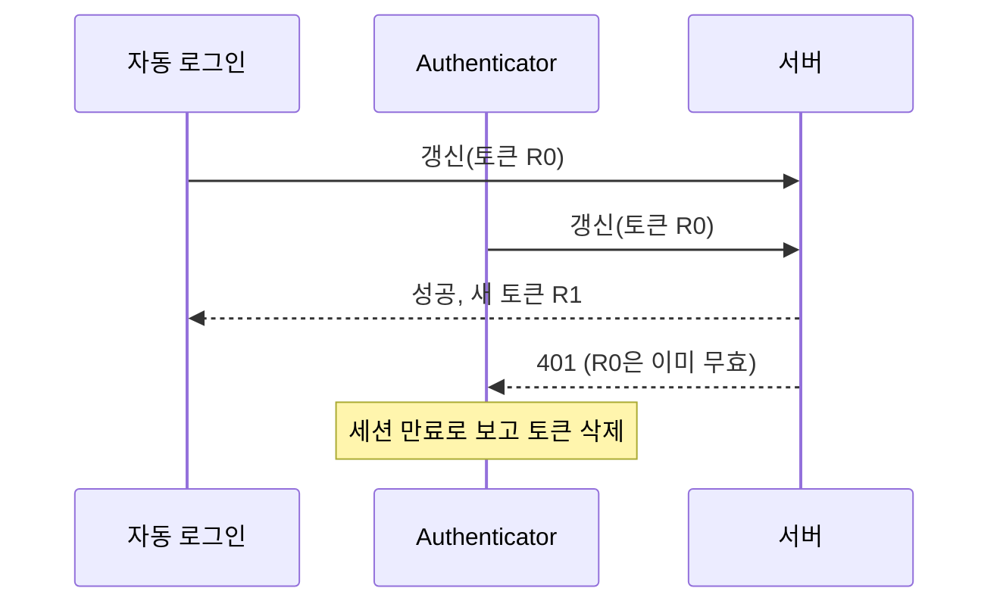
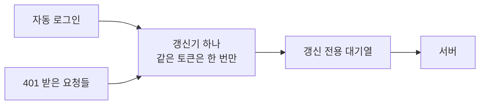

로그인 토큰이 만료되면 알아서 새로 받아 오고 실패한 요청을 다시 보내는 코드를 짜 본 적이 있다면, 처음엔 스무 줄이면 끝난다고 생각했을 것이다. 401이 오면 리프레시 토큰으로 갱신하고, 새 토큰으로 재시도한다. 나도 그렇게 짰다. 그리고 같은 코드에서 석 달 동안 세 번 버그가 났다. 두 번은 레이스 컨디션이었고, 마지막은 앱의 모든 요청이 멈추는 데드락이었다.

이 글은 그 세 번을 순서대로 적는다. 작업한 앱은 [RuleUp-ASM/Android](https://github.com/RuleUp-ASM/Android)다. 안드로이드와 OkHttp 이야기지만 웹에서 axios 인터셉터로 토큰을 갱신하든, 서버에서 커넥션 풀을 쓰든 같은 구조라면 그대로 옮겨 읽어도 된다.

## 용어 몇 개만 맞추고 가자

| 용어 | 이 글에서의 뜻 |
|---|---|
| 액세스 토큰 / 리프레시 토큰 | 요청마다 붙이는 짧은 수명의 출입증과, 그 출입증을 새로 받을 때 쓰는 긴 수명의 교환권 |
| 토큰 회전 | 갱신할 때마다 서버가 리프레시 토큰도 새로 주고 이전 것은 무효로 만드는 방식 |
| OkHttp | 안드로이드에서 가장 많이 쓰는 HTTP 클라이언트. Retrofit이 그 위에서 돈다 |
| Authenticator | OkHttp가 401 응답을 받으면 부르는 콜백. 여기서 새 토큰을 붙인 요청을 돌려주면 OkHttp가 재시도한다 |
| OkHttp Dispatcher | OkHttp가 비동기 요청을 몇 개까지 동시에 내보낼지 정하는 대기열 겸 스레드 풀. 코루틴의 `Dispatchers.IO` 와는 다른 물건이다 |
| 레이스 컨디션 | 두 작업이 같은 자원을 건드리고, 어느 쪽이 먼저 끝나느냐에 따라 결과가 달라지는 상황 |
| 데드락(교착) | 서로가 서로를 기다려서 아무도 진행하지 못하는 상황 |

## 처음 구조

7월에 401 자동 갱신을 붙였다. OkHttp의 [Authenticator](https://javadoc.io/doc/com.squareup.okhttp3/okhttp/5.3.2/index.html)에서 리프레시 토큰으로 새 토큰을 받고 재시도한다. 여러 요청이 동시에 401을 받으면 갱신이 여러 번 나가니 `synchronized` 로 한 번에 하나만 들어오게 했고, 먼저 들어간 쪽이 이미 갱신했으면 나머지는 그 토큰을 쓰게 했다. 줄이면 이런 모양이다.

```kotlin
override fun authenticate(route: Route?, response: Response): Request? {
    synchronized(this) {
        val failedToken = response.request.header("Authorization")?.removePrefix("Bearer ")
        val current = tokenRepository.cachedAccessToken()
        // 실패한 토큰과 지금 토큰이 다르면 다른 스레드가 이미 갱신을 마친 것이다
        if (!current.isNullOrBlank() && current != failedToken) return response.retryWith(current)

        val refreshToken = runBlocking { tokenRepository.getRefreshToken() } ?: return null
        val newToken = runBlocking { tokenRefresher.get().refresh(refreshToken) }  // Retrofit 호출
        if (newToken == null) {
            runBlocking { tokenRepository.clear() }   // 세션 만료로 보고 로그아웃
            return null
        }
        runBlocking { tokenRepository.saveTokens(newToken) }
        return response.retryWith(newToken.accessToken)
    }
}
```

`synchronized` 는 이 Authenticator 안에서만 줄을 세운다. 그리고 `runBlocking` 으로 Retrofit 호출이 끝날 때까지 지금 스레드를 붙잡고 기다린다. 이 두 가지가 각각 한 번씩 문제가 됐다.

## 첫 번째: 문 두 개로 같은 열쇠를 쓰다 (#120)

앱을 껐다 켜면 가끔 로그아웃돼 있었다([#120](https://github.com/RuleUp-ASM/Android/issues/120)). 원인은 갱신이 나가는 길이 두 개였다는 데 있었다. 스플래시 화면의 자동 로그인도 리프레시 토큰으로 갱신을 하고 있었는데, 그 사이 화면이 보낸 다른 요청이 401을 받으면 Authenticator도 갱신을 한다. `synchronized` 는 Authenticator 안에서만 유효하니 둘은 서로를 모른다.



서버는 토큰을 회전시킨다. 먼저 도착한 쪽이 R1을 받는 순간 R0은 무효가 되고, 늦게 도착한 쪽은 401을 받는다. 그 401을 세션 만료로 해석해 토큰을 지우면 방금 받은 R1까지 같이 사라진다.

이때 고친 방식은 "진 쪽이 상황을 확인한다"였다([PR #121](https://github.com/RuleUp-ASM/Android/pull/121)). 갱신에 실패했을 때 저장된 리프레시 토큰이 내가 보낸 것과 다르면, 다른 경로가 이미 갱신에 성공한 것이니 지우지 않는다.

```kotlin
.fold(
    onSuccess = { tokenRepository.saveTokens(it); true },
    onFailure = {
        val latest = tokenRepository.getRefreshToken()
        if (latest != null && latest != refreshToken) true   // 다른 쪽이 이미 회전시켰다
        else { tokenRepository.clear(); false }
    },
)
```

로그아웃은 멈췄다. 그런데 갱신이 두 번 나가는 건 그대로였다. 두 번 나간 뒤에 앱 쪽에서 결과를 맞춰 볼 뿐이었고, 서버는 여전히 무효가 된 R0을 한 번 더 받고 있었다.

## 두 번째: 서버는 기억하고 있었다 (#456)

두 달 뒤 같은 증상이 다시 나왔다([#456](https://github.com/RuleUp-ASM/Android/issues/456)). 이번에는 로그아웃이 바로 오지 않았다. 콜드 스타트 때는 7월에 넣은 분기 덕분에 버텼는데, 한참 뒤 액세스 토큰이 다시 만료돼 새 리프레시 토큰으로 정상적인 갱신을 보내자 그게 401을 받았다.

서버는 이런 흐름이었다. 갱신할 때마다 리프레시 토큰을 회전시키고, 이미 무효가 된 토큰이 다시 들어오면 재사용으로 본다. 재사용이 감지되면 그 토큰에서 이어진 토큰들도 함께 막는다. OAuth 보안 권고인 [RFC 9700](https://datatracker.ietf.org/doc/html/rfc9700#section-4.14.2)이 권하는 방식 그대로다. 서버는 무효가 된 토큰이 들어오면 탈취가 있었다고 보는데, 공격자와 정상 클라이언트 중 누가 보냈는지 구분할 수 없으니 살아 있는 토큰까지 폐기한다.

그러니 7월의 땜질은 앱이 그 순간을 버티게 해 줬을 뿐이다. 서버 입장에서는 콜드 스타트 때 이미 재사용이 일어났고, 그 결과가 다음 갱신 때 나타났다.

그래서 이번에는 갱신을 하나로 모았다([PR #463](https://github.com/RuleUp-ASM/Android/pull/463)). 자동 로그인과 Authenticator가 모두 같은 `TokenRefresher` 를 거치게 하고, 그 안에서 같은 토큰의 갱신은 요청 하나를 나눠 쓰게 했다. 흔히 single-flight라고 부르는 방식이다.

```kotlin
class TokenRefresherImpl @Inject constructor(private val api: AuthApi) : TokenRefresher {
    private val scope = CoroutineScope(SupervisorJob() + Dispatchers.IO)
    private val lock = Mutex()
    private var latest: Pair<String, Deferred<RefreshedSession?>>? = null   // (보낸 토큰, 진행 중이거나 끝난 갱신)

    override suspend fun refresh(refreshToken: String): RefreshedSession? {
        val shared = lock.withLock {
            latest?.takeIf { it.first == refreshToken }?.second
                ?: scope.async { request(refreshToken) }.also { latest = refreshToken to it }
        }
        return try {
            shared.await()
        } catch (e: Exception) {
            // 일시적 실패를 붙잡아 두면 같은 토큰으로 재시도할 때마다 같은 실패를 받는다
            lock.withLock { if (latest?.second === shared) latest = null }
            throw e
        }
    }
}
```

결정이 세 개 들어 있다. 진행 중인 갱신이 있으면 [`Deferred`](https://kotlinlang.org/api/kotlinx.coroutines/kotlinx-coroutines-core/kotlinx.coroutines/-deferred/) 를 같이 기다린다. 이미 끝난 갱신이라도 같은 토큰으로 늦게 온 호출에는 그 결과를 돌려준다. 늦게 온 쪽이 회전 전 토큰을 다시 보내면 서버 입장에서는 또 재사용이기 때문이다. 대신 네트워크 오류나 5xx 같은 일시적 실패는 기억하지 않아서, 다음 호출은 요청을 새로 보낸다. 잠금은 코루틴용 [`Mutex`](https://kotlinlang.org/api/kotlinx.coroutines/kotlinx-coroutines-core/kotlinx.coroutines.sync/-mutex/)를 써서 기다리는 동안 스레드를 막지 않는다.

테스트는 이 세 결정을 그대로 옮겼다. 같은 토큰으로 동시에 두 번 부르면 요청은 한 번만 나가는지, 끝난 뒤 같은 토큰으로 늦게 불러도 다시 안 나가는지, 500 뒤에는 다시 나가는지를 본다.

## 세 번째: 같은 줄에 선 구원자 (#477)

다음 날 더 이상한 게 나왔다([#477](https://github.com/RuleUp-ASM/Android/issues/477)). 액세스 토큰이 만료된 상태에서 요청을 동시에 여러 개 보내는 화면에 들어가자 응답이 하나도 오지 않았고, 그 뒤로는 앱의 모든 API 요청이 멈췄다. 동시에 나가는 요청이 적은 화면에서는 같은 상황에서도 멀쩡했다. 멈춘 화면은 들어갈 때 요청을 5개 보냈다.

5라는 숫자가 단서였다. OkHttp의 [Dispatcher](https://github.com/square/okhttp/blob/parent-5.3.2/okhttp/src/commonJvmAndroid/kotlin/okhttp3/Dispatcher.kt)는 비동기 요청을 전체 64개, 호스트 하나당 5개까지만 동시에 내보낸다. 나머지는 메모리 대기열에서 앞의 요청이 끝나기를 기다린다. Retrofit의 suspend 함수도 내부적으로 OkHttp의 비동기 호출을 쓰기 때문에([KotlinExtensions.kt](https://github.com/square/retrofit/blob/3.0.0/retrofit/src/main/java/retrofit2/KotlinExtensions.kt)의 `enqueue`) 이 한도를 그대로 받는다.

```kotlin
// OkHttp 5.3.2 Dispatcher 기본값
var maxRequests = 64          // 전체 동시 실행 한도
var maxRequestsPerHost = 5    // 호스트 하나당 동시 실행 한도
```

Authenticator는 401을 받은 그 요청의 스레드 위에서 돌고, 그동안 그 요청은 끝난 게 아니라서 자기 칸을 계속 쥐고 있다. 그 상태에서 갱신을 Retrofit으로 보내면 갱신 요청도 같은 Dispatcher의 같은 호스트 대기열에 들어간다. 순서대로 보면 이렇다.

<iframe src="/assets/diagrams/2026-10-14-token-refresh-dispatcher-deadlock.html"
        title="요청 5개가 공용 대기열의 5칸을 모두 쓴 채 401을 받고 갱신 관문에서 기다리며, 갱신 요청은 같은 대기열의 빈 칸을 기다리다 멈추는 순서. 고친 뒤에는 갱신 요청이 별도 대기열로 나가 새 토큰을 받고 5개가 재시도한다"
        loading="lazy" width="100%" height="760"
        style="border:1px solid var(--main-border-color); border-radius:6px;"></iframe>

> 잘려 보이면 [전체 화면으로 열기](/assets/diagrams/2026-10-14-token-refresh-dispatcher-deadlock.html).
{: .prompt-tip }

1. 요청 5개가 출발해 호스트당 5칸을 모두 차지한다.
2. 5개 모두 401을 받고 Authenticator로 들어간다. 하나는 `synchronized` 안에서, 넷은 그 앞에서 기다린다. 다섯 모두 칸을 쥔 채다.
3. 안에 들어간 하나가 갱신 요청을 넣는다. 빈 칸이 없으니 갱신 요청은 대기열에서 기다린다.
4. 칸이 비려면 앞의 5개가 끝나야 하고, 5개가 끝나려면 갱신이 끝나야 한다. 아무도 움직이지 못한다.

요청이 4개였다면 칸 하나가 남아 갱신이 출발했을 것이다. 그래서 동시 요청이 적은 화면에서는 재현되지 않았다. 코드로만 보면 7월에 처음 붙인 구조부터 이 조건이 맞으면 멈출 수 있었다. 동시에 5개가 만료를 맞는 화면에 들어가기 전까지 드러나지 않았을 뿐이다.

고친 방법은 갱신 요청을 다른 줄에 세우는 것이다([PR #479](https://github.com/RuleUp-ASM/Android/pull/479)). 인증 API 전용 Retrofit을 만들고, 거기에 쓰는 OkHttpClient에만 새 Dispatcher를 준다.

```kotlin
@Provides @Singleton @Named(AUTH_RETROFIT)
fun provideAuthRetrofit(okHttpClient: OkHttpClient, json: Json, @BaseUrl baseUrl: String): Retrofit =
    // 동시 401을 받은 호출들이 기본 디스패처의 호스트당 한도(5)를 붙잡고 있어도
    // 갱신은 자기 디스패처에서 출발한다
    buildRetrofit(okHttpClient.newBuilder().dispatcher(Dispatcher()).build(), json, baseUrl)
```

`newBuilder()` 로 만든 클라이언트는 커넥션 풀과 설정은 그대로 나눠 쓰고 Dispatcher만 따로 갖는다. 기다리는 쪽은 기본 Dispatcher의 칸을 쥐고 있고, 기다림을 풀어 줄 갱신은 다른 Dispatcher의 칸을 쓰니 서로 다툴 일이 없다.

다른 방법도 있었다. `maxRequestsPerHost` 를 늘리는 건 한도를 6이나 10으로 옮길 뿐이라 동시 요청이 그만큼 몰리면 같은 일이 난다. 갱신을 비동기 `enqueue` 대신 동기 `execute()` 로 보내면 Dispatcher 한도를 받지 않는데, 그러려면 갱신 경로만 Retrofit의 suspend 함수를 버려야 했다. 전용 Dispatcher가 고치는 범위가 가장 좁았다.

## 세 번을 겪고 남은 것

첫 번째와 두 번째는 같은 레이스였다. 처음에는 결과를 사후에 맞춰서 증상을 덮었고, 그사이 서버는 매번 재사용을 보고 있었다. 두 번째에야 갱신이 나가는 길을 하나로 만들었다. 세 번째는 갱신을 한 줄로 세운 그 관문이, 관문을 통과해야 할 요청과 같은 줄에 서 있어서 생겼다.

지금 갱신 경로를 한 장으로 그리면 이렇다.



## 이 방법이 통하는 조건

토큰이 아니어도 다음 조건이 맞으면 같은 처방이 듣는다.

- 여러 경로가 같은 자원을 새로 받아 오는데 그 작업이 한 번만 성공할 수 있다면(토큰 회전, 일회용 코드, 캐시가 비었을 때 원본 조회), 각 경로가 결과를 사후에 맞춰 보게 하지 말고 진행 중인 작업을 공유하게 한다.
- 상대가 내 요청을 기억한다면(재사용 감지, 멱등성 키, 감사 로그), 앱 쪽에서만 버티는 땜질은 효과가 없다. 상대에게 나간 요청 수를 줄여야 한다.
- 한도가 있는 풀(HTTP 디스패처, 스레드 풀, DB 커넥션 풀) 안에서 블로킹으로 기다리는 코드가 있다면, 기다림을 풀어 줄 작업이 같은 풀을 쓰는지 확인한다. 같다면 풀 크기만큼 동시에 몰리는 순간 멈춘다.
- 이런 버그는 동시에 몇 개가 몰려야 나는지가 조건이다. 테스트에서는 그 개수 이상을 동시에 만들어야 재현된다.

## 참고 자료

- [RuleUp-ASM/Android](https://github.com/RuleUp-ASM/Android): 작업한 앱
- 이슈 [#120](https://github.com/RuleUp-ASM/Android/issues/120) · [PR #121](https://github.com/RuleUp-ASM/Android/pull/121): 첫 번째 레이스와 땜질
- 이슈 [#456](https://github.com/RuleUp-ASM/Android/issues/456) · [PR #463](https://github.com/RuleUp-ASM/Android/pull/463): 갱신 단일화
- 이슈 [#477](https://github.com/RuleUp-ASM/Android/issues/477) · [PR #479](https://github.com/RuleUp-ASM/Android/pull/479): 디스패처 교착
- [OkHttp 5.3.2 API 문서](https://javadoc.io/doc/com.squareup.okhttp3/okhttp/5.3.2/index.html)
- [OkHttp Dispatcher.kt (5.3.2)](https://github.com/square/okhttp/blob/parent-5.3.2/okhttp/src/commonJvmAndroid/kotlin/okhttp3/Dispatcher.kt): `maxRequests`, `maxRequestsPerHost` 기본값
- [Retrofit KotlinExtensions.kt (3.0.0)](https://github.com/square/retrofit/blob/3.0.0/retrofit/src/main/java/retrofit2/KotlinExtensions.kt): suspend 호출이 `enqueue` 를 쓰는 부분
- [Kotlin: Shared mutable state and concurrency](https://kotlinlang.org/docs/shared-mutable-state-and-concurrency.html)
- [kotlinx.coroutines: runBlocking](https://kotlinlang.org/api/kotlinx.coroutines/kotlinx-coroutines-core/kotlinx.coroutines/run-blocking.html)
- [kotlinx.coroutines: Mutex](https://kotlinlang.org/api/kotlinx.coroutines/kotlinx-coroutines-core/kotlinx.coroutines.sync/-mutex/)
- [RFC 9700: OAuth 2.0 Security Best Current Practice, 4.14.2 리프레시 토큰 보호](https://datatracker.ietf.org/doc/html/rfc9700#section-4.14.2)
