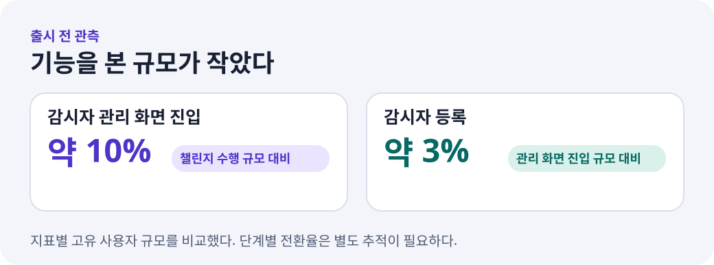
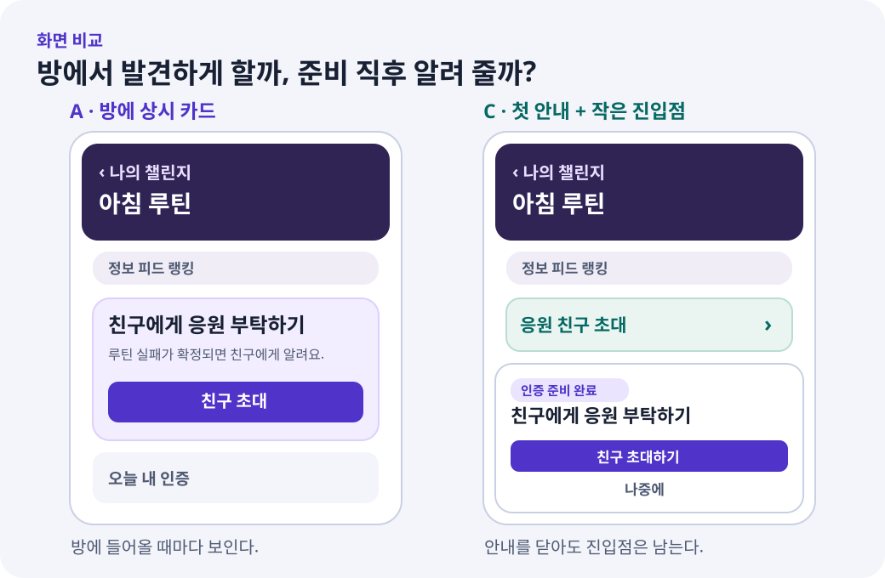
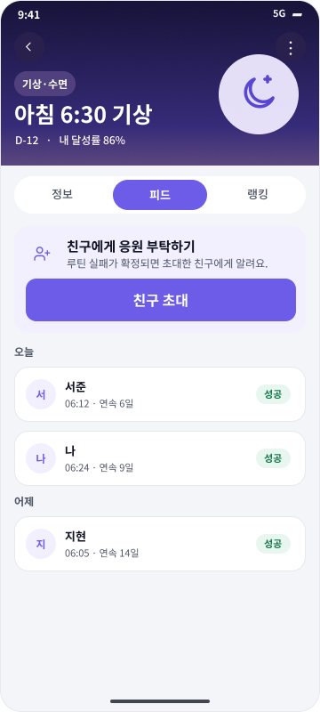
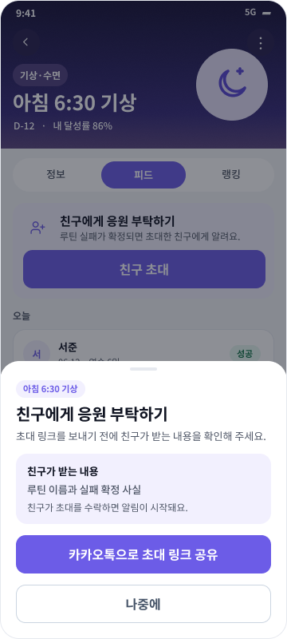
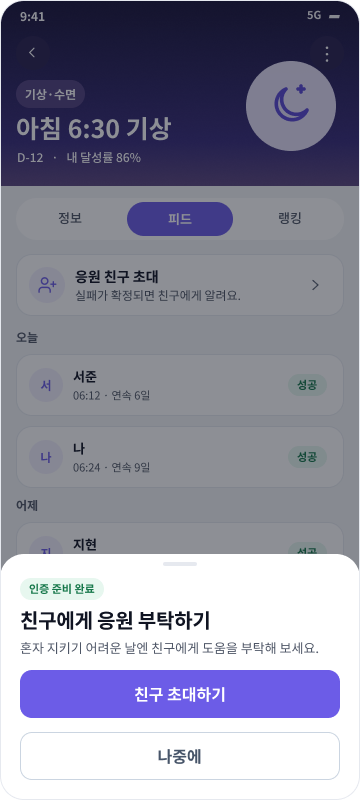
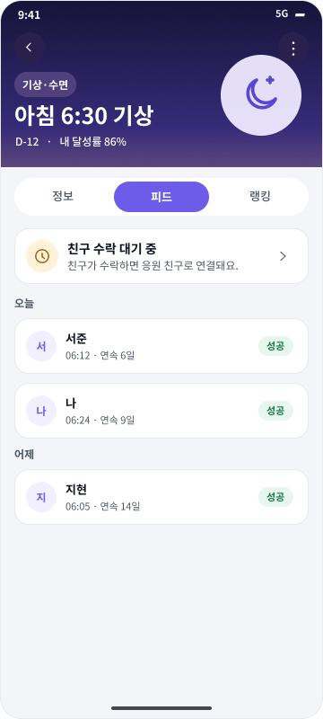
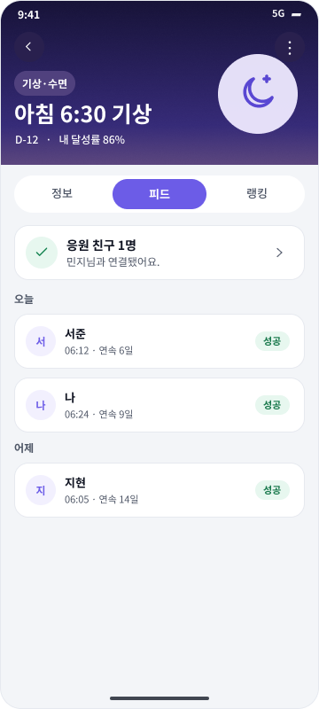
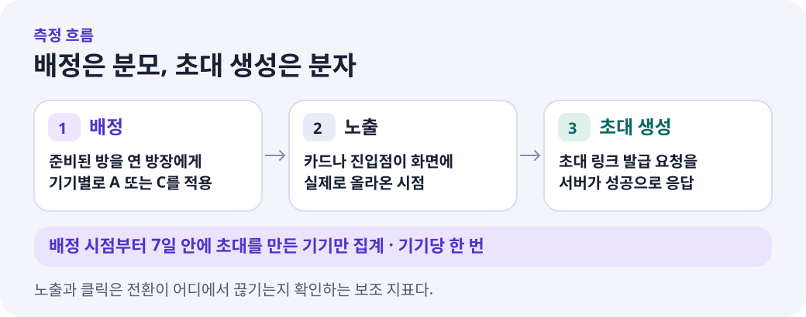
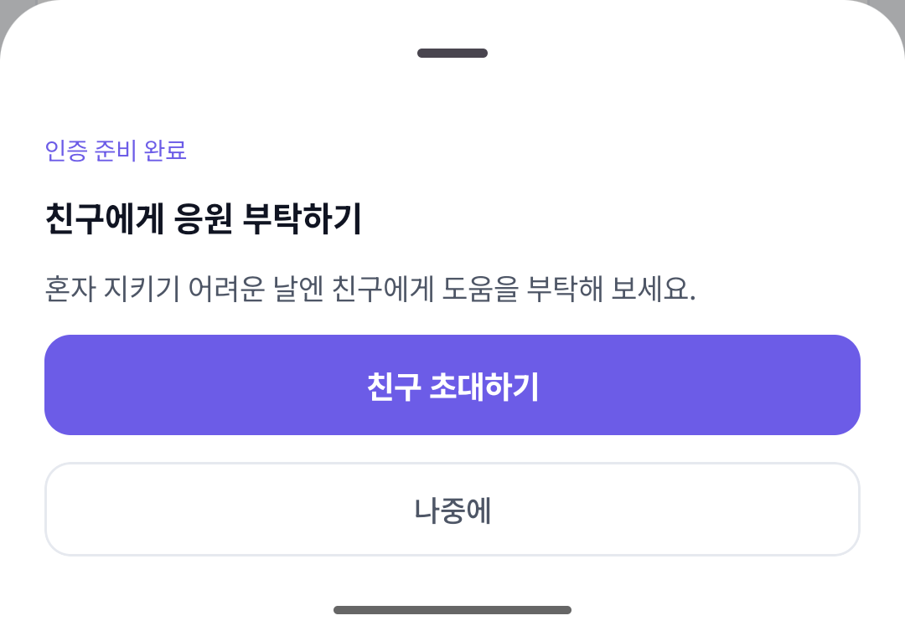

룰업에는 루틴을 지키기 어려울 때 친구에게 도움을 부탁하는 기능이 있다. 친구가 초대를 수락하면 루틴 실패가 확정됐을 때 알림을 받는다. 앱 안에서는 이 친구를 **감시자**라고 불렀다.

기능은 이미 돌아가고 있었는데 등록이 드물었다. 처음에는 초대 화면 안에서 뭘 고쳐야 할지 생각했다. 그러다 먼저 확인할 질문이 생겼다. 사람들이 초대 화면까지 갔다면, 그 화면을 고치는 게 맞다. 그런데 방에서 초대할 수 있다는 사실을 어디서 알게 되는 걸까?

## 등록보다 먼저 관리 화면 진입을 봤다

관리 화면 진입에 가까운 화면 표시 이벤트에서 고유 사용자를 세어 봤다. 관리 화면에 들어온 규모는 챌린지를 수행한 규모의 **약 10%**였다. 감시자 등록 규모는 관리 화면 진입 규모의 **약 3%**였다. 두 비율은 지표별로 따로 센 고유 사용자 규모를 비교한 값이다. 같은 사람이 방을 열고 관리 화면을 거쳐 등록했는지를 보려면 사용자별로 이벤트를 연결해야 한다.

{: width="1040" height="387" }
_당시 집계의 규모 비교. 단계별 전환율을 내려면 초대할 수 있었던 기기부터 따로 세어야 한다._

방마다 초대 조건도 다르다. 챌린지를 수행한 사람에는 일반 참여자와 인증 준비를 진행 중인 사람도 포함된다. 그래서 이 집계에서는 초대할 수 있었던 사람의 규모를 따로 알기 어려웠다. 그래도 관리 화면에 들어오는 규모가 작았다는 사실은, 그 화면 안을 고치기에 앞서 **방에서 초대 기능을 어떻게 발견하는지**부터 볼 이유가 됐다.

## 초대할 수 있다는 사실을 모른다는 가설

가장 먼저 세운 가설은 이랬다. **방장이 인증 준비를 끝내고 방에 들어왔을 때 친구를 초대할 수 있다는 사실과 초대 목적을 바로 알면, 7일 안에 초대를 만드는 비율이 높아질 것이다.**

다른 설명도 가능했다. 초대할 수 있는 방 자체가 적었을 수 있다. 기능을 보고도 친구에게 루틴 실패를 알리는 게 부담스러웠을 수 있다. 친구에게 어떤 정보가 가는지 알기 어려웠을 수도 있다. 첫 실험에서는 준비가 끝난 방장만 대상으로 잡고, 두 화면에서 친구가 받는 정보와 초대 방식은 맞췄다. 비교하고 싶은 건 **기능을 보여 주는 위치와 순간**이었다.

## A는 방에 두고, C는 준비 직후 한 번 알린다

{: width="1040" height="680" }
_핵심 배치와 동선을 보여 주기 위해 실험 화면을 다시 그렸다._

- **A · 상시 카드.** 방 상단에 ‘친구에게 응원 부탁하기’ 카드와 초대 버튼을 둔다. 나중에 초대하고 싶어졌을 때 방을 다시 열면 같은 자리에서 찾을 수 있다.
- **C · 첫 안내와 작은 진입점.** 초대하거나 연결한 친구가 없는 첫 화면에서 안내를 한 번 띄운다. 인증 준비를 방금 끝낸 경우에는 ‘인증 준비 완료’ 배지를 붙인다. 이미 준비된 방을 다시 열었을 때도 안내를 처음 볼 수 있고, 안내를 닫으면 방에 작은 ‘응원 친구 초대’ 진입점이 남는다.

두 안에서 사용자는 공유 전에 친구가 받는 내용을 확인한다. 친구에게 전달되는 내용은 루틴 이름과 실패가 확정됐다는 사실이고, 알림은 친구가 초대를 수락한 뒤 시작된다. 이렇게 맞춰야 화면을 어떻게 보여 줬는지의 차이를 비교하기 쉽다.

### Figma 원본 시안

아래 시안의 이름과 화면 속 숫자는 예시다.

**A · 방 상단 카드와 공유 확인**

  <figure class="text-center" style="flex: 1 1 160px; max-width: 220px;">
    
    <figcaption>방을 열면 상단에서 친구에게 응원을 부탁할 수 있다.</figcaption>
  </figure>
  <figure class="text-center" style="flex: 1 1 160px; max-width: 220px;">
    
    <figcaption>공유하기 전에 친구에게 어떤 알림이 가는지 보여 준다. 이 확인 화면은 두 안에 공통으로 적용한다.</figcaption>
  </figure>

**C · 첫 안내에서 연결까지**

  <figure class="text-center" style="flex: 1 1 160px; max-width: 220px;">
    
    <figcaption>인증 준비를 마치면 첫 안내가 뜬다.</figcaption>
  </figure>
  <figure class="text-center" style="flex: 1 1 160px; max-width: 220px;">
    
    <figcaption>링크를 만든 뒤 방에서 수락을 기다리는 상태를 볼 수 있다.</figcaption>
  </figure>
  <figure class="text-center" style="flex: 1 1 160px; max-width: 220px;">
    
    <figcaption>친구가 수락하면 방에 연결 상태가 표시된다.</figcaption>
  </figure>

A와 C 모두 기존 화면을 바꾼 안이다. 이 실험에서 답할 질문은 **두 방식 중 어느 쪽이 초대를 더 많이 만드는가**다. 기존 화면 대비 개선 폭을 알려면 기존 화면을 대조군으로 넣은 별도 비교가 필요하다.

## 초대 링크가 만들어진 기기를 센다

Amplitude에서 인증 준비가 끝난 방을 연 방장에게 기기 ID 기준으로 A와 C를 50:50 배정한다. 같은 실험에서는 같은 기기에 같은 안이 돌아간다. 화면을 다시 열거나 앱을 재시작할 때마다 안이 바뀌면 어느 화면이 행동에 영향을 줬는지 가리기 어렵기 때문이다. 새 실험을 시작할 때만 다시 배정한다.

{: width="1040" height="410" }

| 구분 | 무엇을 세는가 | 왜 보는가 |
| --- | --- | --- |
| **주 지표** | A 또는 C를 배정받은 고유 기기 중 **배정 후 7일 안에 서버가 초대 링크를 발급한 기기의 비율** | 화면을 바꾼 뒤 초대 생성 행동이 달라졌는지 판단한다 |
| 노출 | 초대 카드나 진입점이 화면에 실제로 표시된 기기 | 배정받은 기기까지 화면이 제대로 도달했는지 확인한다 |
| 클릭 | 초대 공유 확인 화면에 들어간 기기 | 화면을 본 뒤 어디에서 멈췄는지 해석한다 |
| 첫 진입 맥락 | 방금 인증 준비를 끝냈는지, 이미 준비된 방을 다시 열었는지 | 안내가 어느 순간에 잘 작동하는지 살펴본다 |

분모는 **배정받은 기기**, 분자는 **그중 7일 안에 초대 링크를 만든 기기**다. 같은 기기가 링크를 여러 번 만들어도 한 번만 센다. 링크 생성 이후 카카오톡 전송, 상대의 수락, 실제 알림까지는 각자 별도의 행동이다. 이번 지표는 그중 앱에서 확인 가능한 첫 행동을 잡는다.

노출을 분모로 삼으면 화면을 보여 주는 데 실패한 기기가 계산에서 빠진다. 그 차이도 UI가 잘 전달됐는지 판단하는 데 중요해서, 배정 분모로 결과를 내고 노출률은 따로 본다. Amplitude의 기본 실험 분석 화면은 노출을 분모로 쓰는 지표가 있으므로, 이번 주 지표는 이벤트를 배정부터 연결한 별도 퍼널로 본다. [Amplitude의 실험 분석 지표](https://www.amplitude.com/docs/feature-experiment/analysis-view)

## 화면은 지금 고른 안을 계속 쓴다

앱은 방을 열 때 원격 설정에서 어떤 안을 보여 줄지 정한다. 화면을 사용하는 중에 새 설정을 받아도 현재 앱 실행에서는 이미 고른 안을 유지한다. 운영에서 실험을 끄면 다음 실행에 새 설정을 적용하고, 이미 배정된 기기는 원래 배정 기준으로 7일 동안 전환을 센다. 앱을 다시 실행하는 시점과 결과 집계를 끝내는 시점을 각각 정한 이유다.

## 어느 정도 차이가 나야 성공인가

성공의 방향은 **7일 초대 생성률이 상대 안보다 높아지고, 그 차이가 화면을 바꿀 만큼 큰 것**이다. 다음 판단 규칙은 운영 실험을 열기 전에 확정할 항목이다.

1. **표본과 관측 기간을 먼저 정한다.** 예를 들어 최소 **2%p** 차이가 있어야 화면을 바꿀 가치가 있다고 정했다면, 예상 전환율을 바탕으로 그 차이를 판별할 표본을 계산한다. 가령 4%와 6%의 차이가 2%p다. 이 숫자는 설명을 위한 예시다. 마지막으로 배정된 기기까지 7일이 지나면 결과를 비교한다. [Amplitude의 최소 감지 효과 설명](https://www.amplitude.com/docs/feature-experiment/experiment-theory/experiment-set-mde)
2. **A와 C의 차이를 %p와 신뢰구간으로 함께 본다.** 미리 정한 표본을 모은 뒤 양측 95% 신뢰구간이 0을 벗어나고 관측 차이가 합의한 최소 폭 이상이면 우세한 안을 채택할 근거가 된다. 우연에 따른 변동을 감안했을 때 어느 쪽이 앞섰는지 판단할 수 없으면 결론을 보류한다.
3. **배정과 계측이 정상인지 확인한다.** A/C 배정 규모가 50:50에서 통계적으로 크게 벗어났거나, 한쪽에서 배정 뒤 노출 이벤트가 유독 빠졌다면 먼저 원인을 확인한다. 초대 생성 API 실패율과 방의 핵심 인증 행동도 같이 봐서 초대 증가가 다른 흐름의 손실을 가리고 있는지 살핀다. [Amplitude의 배정 비율 불일치 진단](https://www.amplitude.com/docs/feature-experiment/troubleshooting/sample-ratio-mismatch)

C의 클릭만 늘고 초대 생성률이 비슷하다면, 안내를 알아차리기는 했지만 친구에게 부탁하는 단계까지 이어졌다는 근거는 부족하다. 반대로 C의 초대 생성률이 높다면 준비 직후 안내와 작은 진입점을 묶은 방식이 이번 비교에서 효과를 보인 것이다. 배지, 안내 타이밍, 작은 버튼 중 어느 요소가 차이를 만들었는지 알고 싶다면 요소를 하나씩 바꿔 보는 후속 실험이 필요하다.

## QA에서 확인한 건 결과를 셀 수 있다는 것

스테이징에서 A와 C를 각각 실행해 배정, 화면 노출, 초대 생성 성공이 Amplitude의 QA 프로젝트에 들어오는 것을 확인했다. C에서 인증 준비를 끝낸 뒤 바로 들어왔는데도 기존 방 재진입으로 기록되는 경우를 발견해 수정했다. 다시 시험했을 때 완료 배지가 뜨고, 노출 이벤트에도 `new_ready`가 들어왔다.

{: width="1080" height="760" }
_Android QA 앱에서 인증 준비 직후 방을 열었을 때 실제로 표시된 C 안내다._

이 글은 실험을 설계하고 측정 경로를 검증한 기록이다. 글을 쓰는 시점에 운영 실험은 시작 전이라 어느 화면이 더 효과적인지는 아직 모른다. 운영 결과를 볼 때는 처음 정한 질문인 **“준비가 끝난 방장이 7일 안에 친구에게 보낼 초대를 만들었나”**로 돌아가면 된다.
